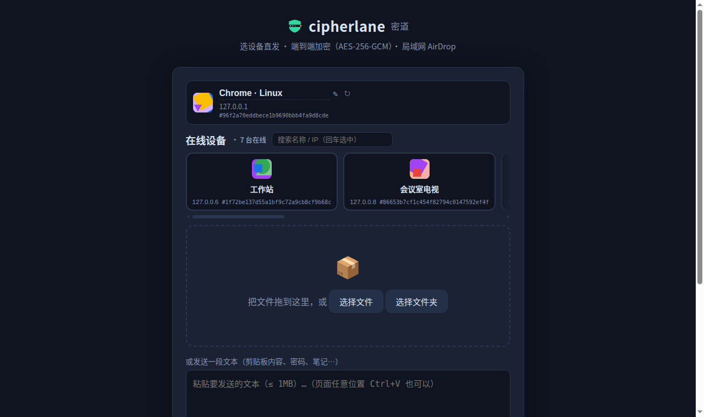
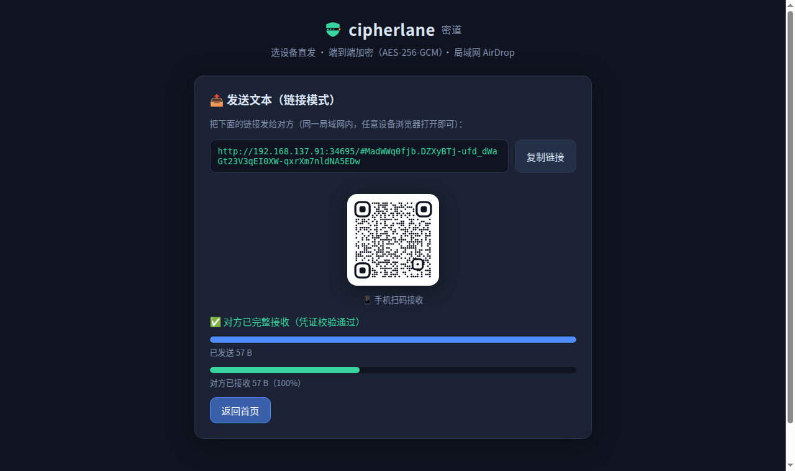
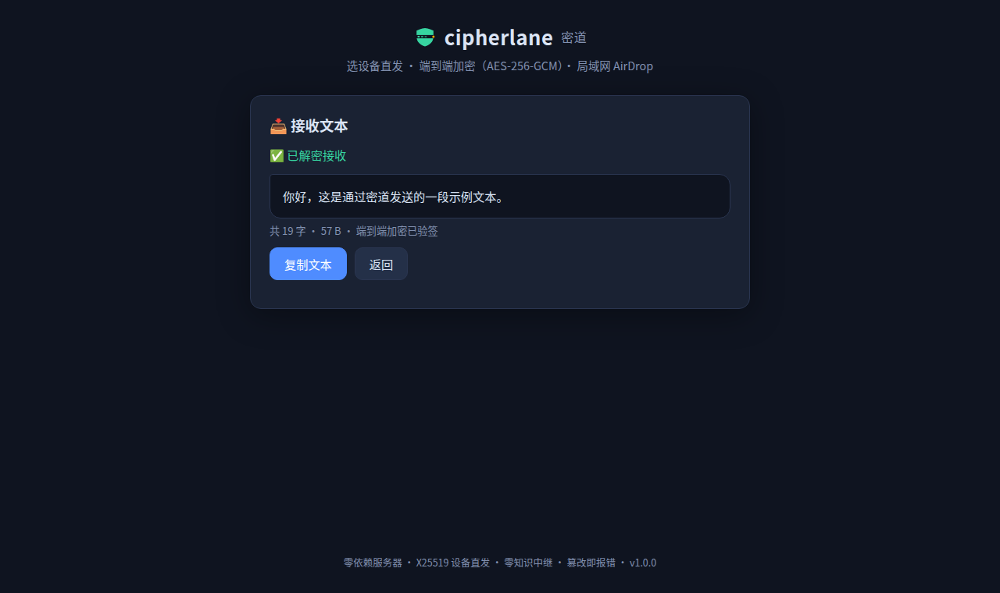

<div align="center">


# cipherlane

**End-to-end encrypted transfers on your LAN — an AirDrop for your local network**

Send device-to-device (X25519 key agreement) or via shareable links. Content stays encrypted even over plain HTTP.

English | [简体中文](README.zh-CN.md)

    

</div>

---

## Contents

- [Two Ways to Send](#two-ways-to-send)
- [Screenshots](#screenshots)
- [Quick Start](#quick-start)
- [How It Works & Protocol](#how-it-works--protocol)
- [Security Model](#security-model)
- [Packaging & Deployment](#packaging--deployment)
- [Browser Compatibility](#browser-compatibility)
- [FAQ](#faq)
- [Project Layout](#project-layout)
- [Tests](#tests)
- [Changelog](#changelog)
- [Roadmap](#roadmap)
- [License](#license)

## Two Ways to Send

| | Device Direct (default) | Link Mode |
| --- | --- | --- |
| Best for | Same LAN, pick & send | Across subnets / via chat apps or email |
| Key | X25519 negotiated inside both browsers, **never crosses the network** | Random key lives in the URL `#fragment`, delivered out of band |
| Passive sniffing / server logs | ✓ protected / ✓ protected | ✓ / ✓ |
| Malicious-server MITM | ✗ (public keys are distributed by the server — see [Security Model](#security-model)) | ✓ (key never reaches the server, fully zero-knowledge) |

One LAN IP = one device: each device gets a **name** (editable), a **geometric avatar** (deterministically generated from its IP, Material-flat style), and an **X25519 identity key** (kept in the browser's localStorage).

## Screenshots

| Device-direct home (single-row devices + search + 32-hex fingerprint) | Link mode, transfer done (QR + ack proof) | Text receive (decrypt & display) |
| :---: | :---: | :---: |
|  |  |  |

`Ctrl+V` anywhere on the page sends your clipboard: screenshots/files go straight out, text goes directly if a device is selected (or fills the input box otherwise).

## Quick Start

Install the package for your platform (see [Packaging & Deployment](#packaging--deployment)), or build from source with a Rust toolchain:

```bash
cargo build --release --manifest-path cipherlane-rs/Cargo.toml
./cipherlane-rs/target/release/cipherlane   # default port 7777 (PORT= to change);
                                            # binds 127.0.0.1 + LAN (RFC1918) interfaces by default (HOST=0.0.0.0 for all interfaces)
```

The server prints its LAN address (e.g. `http://192.168.1.117:7777`). On any device on the **same Wi-Fi**, open it in a browser:

1. Set your name on the home page → the other side appears under "online devices"
2. Select a device → drop a file / paste text → the other side gets an invitation card (with the decrypted file name and size) → accept to receive

Machines without a browser can use the native CLI `cipherlane-cli` (fully interoperable with the web UI):

```bash
cipherlane-cli devices --server http://192.168.1.117:7777        # list online devices
cipherlane-cli send big.zip --to 192.168.1.50 --server http://... # direct send (no link needed)
cipherlane-cli send big.zip --to 192.168.1.50 --verify 3f2a9c1b --server http://... # pin the target fingerprint
cipherlane-cli listen --yes -o ~/downloads --server http://...    # resident receiver (can be direct-sent to)
cipherlane-cli send big.zip --server http://...                   # link mode: prints a receive link
cipherlane-cli send a.zip dir/ --server http://...                 # batch: multiple paths + recursive directories
cipherlane-cli recv 'http://.../#ROOM.KEY' [-o output path]       # link-mode receive
```

## How It Works & Protocol

<details>
<summary>Architecture diagram (click to expand)</summary>

```
Sender browser/CLI                    LAN (plain HTTP, sniffable)             Receiver browser/CLI
┌─────────────┐  discovery/X25519 pub  ┌──────────────┐                     ┌─────────────┐
│ pick target  │ ◀─────────────────▶ │  dumb relay    │ ◀────────────────▶ │ picked from  │
│ ECDH → key   │    (sees only pubs)  │ sees only      │   (sees only pubs)  │ ECDH → key   │
│ AES-GCM enc  │ ──── ciphertext ───▶ │ ciphertext     │ ──── ciphertext ───▶ │ AES-GCM dec  │
└─────────────┘                      └──────────────┘                     └─────────────┘
   room key = SHA-256( X25519 shared secret ‖ both public keys ‖ room id ), derived identically on both sides
```

</details>

**Protocol at a glance** (all endpoints in `cipherlane-rs/src/main.rs`; limits are defaults):

| Endpoint | Purpose |
| --- | --- |
| `POST /api/presence` | Device heartbeat (last writer wins per IP, 5s heartbeat / 20s TTL) |
| `GET /api/devices` | Online device list (IP / name / X25519 public key) |
| `POST /api/rooms` | Create a transfer room (10-char base62 id ≈ 59.6 bits) |
| `POST /api/rooms/:id/chunk` | Post ciphertext chunk (1 MiB plaintext each, backpressure window 64, requires room token; optional `X-Chunk-Seq` idempotency sequence so timeout retries never duplicate chunks) |
| `GET /api/rooms/:id/chunk?i=N` | Sequential pull (25s long-poll, one-shot consumption) |
| `POST /api/rooms/:id/offer` | Attach a direct-send invitation (encrypted preview hint, must precede chunks) |
| `GET /api/offers` | Long-poll this device's pending invitations (**secret + source IP double binding**) |
| `POST /api/offers/:id/accept\|reject` | Accept / reject (rejected rooms live 2 more minutes for the sender to observe) |
| `POST /api/rooms/:id/done` / `ack` | Sender finished / receiver confirmed (ack carries a key proof verified locally by the sender); idle rooms are reclaimed after 15 min |

Limits: 64 chunks / 64 MB backpressure per room, 256 MB global, 64 rooms / 96 MB buffered / 120 creates per minute per IP, ≤ 8 pending offers per device (5 min TTL), ≤ 256 devices.

**Protocol v2 (v0.5.0+)**: every chunk is bound to its position via `AAD = cipherlane/chunk/v2|<room>|<index>`, so reordered, replayed or misplaced chunks are rejected by GCM; receivers verify the total plaintext length at the end (text / each file / total) and never ack on mismatch. Transfers sent by v0.5.0 **cannot be decrypted by v0.4.x receivers** (upgrade both ends together); new receivers remain compatible with old senders (v2 first, fall back to v1). Since v0.5.1 chunk posts may carry an optional `X-Chunk-Seq` idempotency sequence (backward compatible): timeout/backpressure retries reuse the same sequence, so the server accepts each chunk only once — no duplicates or misalignment.

## Security Model

| Threat | Defense |
| --- | --- |
| LAN sniffing (plain HTTP) | Content, file names and types are all AES-256-GCM encrypted; every chunk is individually authenticated |
| The server operator (link mode) | Zero knowledge: the random key travels in the URL `#fragment`, peer to peer, and never reaches the server |
| The server operator (device direct) | Room key derived via X25519; the server sees only public keys and ciphertext — old logs stay useless |
| Stolen device secret | Useless: claiming an invitation requires **both the secret and the matching source IP** — a different machine gets 401 |
| Link obtained by a third party | Room ids are unenumerable; chunks are consumed one-shot — once someone pulls them, others get 410 |
| Tampering in transit | GCM auth tags verified per chunk with AAD binding room + chunk index; total plaintext length is verified at the end; invitations whose preview fails verification are auto-rejected |
| Impersonating the sender | Posting chunks requires the random room token (held by the sender only; sniffable on plain HTTP, so integrity still relies on GCM) |
| Forged delivery confirmation | ack carries a key proof SHA256(key‖label‖room); sender verifies locally and flags proof-less acks |
| Small-order / invalid public keys | X25519 all-zero shared secret is rejected (RFC 7748 requirement) |
| Room / memory abuse | 64 MB per room, 256 MB global, 64 rooms / 96 MB / 120 creates per minute per IP; 429 beyond that; idle rooms reclaimed automatically |

**Known boundaries (stated honestly)**:

- **Device-direct mode cannot automatically stop an active MITM by the server**: device public keys are distributed by the server, so a malicious server could substitute keys and impersonate the receiver. The mitigation is **public-key fingerprints** (TOFU): device cards and your own card show a **128-bit (32-hex)** fingerprint, and a changed key is flagged "⚠ key changed" persistently; both direct sends and incoming invitations require explicit confirmation when the key changes, and the CLI can pin it with `--verify <prefix>` — comparing fingerprints out loud defeats substitution, but the system will not compare them for you; the ↻ button on your card resets the identity key at any time. For the highest assurance, use link mode
- **The page itself is served over plain HTTP**: E2EE protects against passive observers only; an active on-path attacker could in principle replace the served JavaScript (the same class of risk as opening any plain-http site). Use a VPN on untrusted networks
- Device names and presence are visible to the server and to anyone who opens the page on the LAN — the inherent cost of device discovery
- The server binds 127.0.0.1 + LAN (RFC1918) interfaces by default, not VPN/tun or virtual adapters; the deb service template follows the same default — override with a systemd drop-in setting `HOST=0.0.0.0` only if you really need all interfaces
- `/api/*` validates Host and Origin (anti-DNS-rebinding / CSRF); if you open the page through a custom hostname (reverse proxy, mDNS, hosts alias), whitelist it via `CIPHERLANE_EXTRA_HOSTS=<host1>,<host2>` or API calls return 403 while the page still loads
- Resumable receiving in link mode (replayable chunks + progress release; browsers use IndexedDB, CLI resumes via `.part`); not supported for device-direct mode or multi-file batch receives — those must be resent after a refresh
- Malicious packet dropping is DoS — detectable (stalled transfer / errors) but not preventable
- Room ids travel in plaintext HTTP requests: on fully sniffable networks an attacker can pull chunks (ciphertext they cannot decrypt) — in resumable rooms chunks are read-only, so stealing no longer starves the receiver; forging progress reports can still cut a transfer (availability-level, same class as before). Confidentiality is unaffected
- Multiple **different browsers** on one IP: the device entry belongs to the last one to register (same-browser tabs share the secret and coexist)

**How encryption works over plain http**: browsers only expose `crypto.subtle` in secure contexts. This project ships pure-JS implementations and degrades automatically: AES-256-GCM (`public/aesgcm.js`), SHA-256 (`public/sha256.js`), X25519 (`public/x25519.js`, BigInt + RFC 7748 Montgomery ladder). On localhost/https, AES uses native WebCrypto. The pure-JS output is byte-identical to the native Rust implementation (cross-checked by the Rust test suite).

## Packaging & Deployment

One command per platform produces the release artifacts; target machines need **no runtime installed** (native Rust binaries, frontend embedded at compile time):

```bash
sh build/package.sh            # artifacts in build/dist/ (run natively on Linux / macOS / Windows Git Bash)
```

| Artifact | Platform | Install / use |
| --- | --- | --- |
| `cipherlane_<v>_amd64.deb` | Linux x64 (Ubuntu/Debian) | `sudo dpkg -i …deb && sudo systemctl enable --now cipherlane` (ships a systemd unit, desktop entry and tray autostart; installs `cipherlane`, `cipherlane-cli`, `cipherlane-tray`) |
| `cipherlane_<v>_windows_x64.zip` | Windows x64 | Unzip and double-click `cipherlane.exe` (console shows address + QR code); `cipherlane-cli.exe` is the CLI |
| `cipherlane_<v>_macos_universal.tar.gz` | macOS arm64 + x64 | Unzip and double-click `cipherlane.command` (if Gatekeeper complains: right-click → Open); `cipherlane-cli` is the CLI |

**All three platforms ship the same Rust implementation** — server, CLI and (on Linux) the system tray. The web UI is compiled into the server with `include_bytes!`, so one static binary serves everything; there is no Node dependency at build or run time. Linux uses static musl (server ≈0.95 MB, tray ≈2.3 MB, deb ≈1.3 MB); the Windows zip and macOS universal bundle are native release builds — actual sizes are printed by the release workflow. Every run writes `cipherlane-<version>-SHA256SUMS.txt`; tag builds publish a unified checksum alongside the three artifacts. **Naming convention**: artifacts are `cipherlane_<version>_<platform>.<format>`; the startup banner and page footer both carry the version — quote it when reporting issues.

Source build (Rust toolchain only): `cargo build --release --manifest-path cipherlane-rs/Cargo.toml`.

## Browser Compatibility

| Requirement | Notes |
| --- | --- |
| BigInt (for X25519) | Chrome 67+ / Edge 79+ / Firefox 68+ / Safari 14+ |
| Streaming save (optional) | Chromium-based browsers support `showSaveFilePicker`; others fall back to in-memory download |
| Paste-to-send (optional) | Any modern browser with clipboard events; on mobile, long-press paste into the text box |

The CLI is a native binary (`cipherlane-cli`); no runtime is required.

## FAQ

**The page still looks old after an upgrade / server restart?**
Static assets are loaded into memory at server start, and the browser may reuse an old tab — **close and reopen the tab** or hard-refresh (Ctrl+Shift+R).

**`EADDRINUSE: 7777` on startup?**
The port is taken. Start with `PORT=7788 ./cipherlane` (source build) or set `PORT` in the systemd unit, or stop the old process.

**My phone can't see devices / others can't see me?**
All devices must be on the **same Wi-Fi/subnet**; check that the OS firewall allows the port (Windows asks once); make sure you opened the LAN address printed at startup, not `127.0.0.1` (loopback is local-only).

**Popups don't work in ZCode / Electron embedded browsers?**
Some embedded webviews lack `alert/confirm` and file savers — a host limitation. Use a real browser (Chrome / Edge / Safari) for serious work.

**QR code looks distorted in an IDE integrated terminal?**
IDE terminals (Electron/xterm.js) deviate from the standard 2:1 cell geometry, which can distort ASCII QR art — a rendering quirk of those environments; standard terminals (GNOME Terminal / Windows Terminal / iTerm) are fine. In an IDE terminal use the fallbacks: `cipherlane-qr-<pid>.png` in the system temp directory (pixel-exact; the banner prints the full path), or the SVG QR on the send page. `CIPHERLANE_QR_RATIO=<measured ratio>` corrects manually.

**Receiver refreshed mid-transfer of a big file?**
Link mode now resumes: reopen the same receive link (CLI: re-run the same command with the same output path) and it continues from the breakpoint. Device-direct and browser batch receive are not resumable yet — resend.

**The browser asks to "download multiple files" when receiving a batch?**
Memory mode triggers downloads one by one and the browser asks once for permission — allow it. Chromium browsers instead show a directory picker before receiving and stream straight into it, no prompt.

**How fast is the pure-JS path?**
Plain http (`http://<LAN IP>`) is a non-secure context, so encryption runs the pure-JS AES: a single worker does about 17 MiB/s, and the page keeps 3 chunks in flight — measured receive ≈32 MiB/s and send ≈30 MiB/s (100 MiB file, headless Chrome 158, dev-machine numbers). On localhost/https the native WebCrypto path is used; memory-mode receive runs at ≈55–65 MiB/s there. X25519 is milliseconds, imperceptible.

## Project Layout

```
cipherlane/
├── cipherlane-rs/          # the whole product + its Rust test suites
│   ├── Cargo.toml          # version + the three bins (cipherlane / cipherlane-cli / cipherlane-tray)
│   ├── src/
│   │   ├── main.rs         # relay server (rooms / presence / invitations) + embedded web UI
│   │   └── bin/            # cli.rs (cipherlane-cli) · tray.rs (cipherlane-tray, Linux only)
│   └── tests/              # Rust suites: crypto / protocol / cli / browser / consistency
├── public/                 # browser frontend (vanilla JS; pure-JS crypto for plain-HTTP contexts)
│   ├── index.html          # SPA (device grid · geometric avatars · invitation cards · dual receive layouts)
│   ├── app.js              # send/receive logic + dual crypto paths + X25519 identity
│   ├── aesgcm.js           # pure-JS AES-256-GCM (plain-http fallback path)
│   ├── sha256.js           # pure-JS SHA-256 (KDF)
│   ├── x25519.js           # pure-JS X25519 (device-direct key agreement)
│   ├── avatar.js           # geometric avatars (Material-flat, deterministic from IP)
│   └── style.css
├── build/package.sh        # one-shot packaging: .deb / Windows zip / macOS universal
├── logo/                   # logo art (main + favicon master)
└── docs/screenshots/       # README screenshots
```

## Tests

Everything — including the browser suite — runs under `cargo test`; the repository has **no Node dependency**. The browser frontend is plain JS (the browser's own language) and is verified by Rust tests that drive a real headless Chrome over CDP.

```bash
cargo build --release --manifest-path cipherlane-rs/Cargo.toml                    # release build
cargo test  --release --manifest-path cipherlane-rs/Cargo.toml                    # all suites
cargo test  --release --manifest-path cipherlane-rs/Cargo.toml --test protocol    # one suite: crypto / protocol / cli / browser / consistency
cargo test  --release --manifest-path cipherlane-rs/Cargo.toml --test screenshots -- --ignored  # regenerate docs/screenshots (needs Chrome)
```

- **crypto**: ported FIPS 197 / FIPS 180-4 / RFC 7748 vectors and random cross-checks (AES-256-GCM incl. AAD, SHA-256, X25519, QR code, avatars); expected values are computed with RustCrypto crates
- **protocol**: spawns the real Rust server binary; covers presence/invitations/accept/reject/limits/same-IP rotation/concurrent pulls/ack proofs/ETag/Host checks/link mode end to end (CI also runs it against the musl release binary)
- **cli**: real-subprocess end-to-end against `cipherlane-cli` + the Rust server — single file / recursive directory batch (nested · CJK names · empty files · hidden entries skipped) / mixed paths / text / SIGKILL-resume, byte-level comparison
- **browser**: a Rust CDP client drives a real headless Chrome (two-page send/receive, error paths, worker-pool assertion); auto-skips when no Chrome is available
- **consistency**: README badges ↔ `Cargo.toml` version, `include_bytes!` ↔ `public/`, required bins and test targets, plus a zero-Node guard over product code, build scripts, CI workflows and README command blocks

## Changelog

**v1.0.0** (2026-10-20, single implementation)
- **Node is gone from the repository**: server, CLI, tray and the entire test suite are Rust. The Node relay/CLI, the Node single-executable packaging path and the Node test runner are all removed; the browser frontend stays plain JS and is exercised by Rust tests through CDP
- **Tests are Rust too**: all suites (`crypto` / `protocol` / `cli` / `browser` / `consistency`) run with `cargo test`; the browser suite is a Rust CDP client driving real headless Chrome, and the consistency guard enforces the zero-Node rule
- **Native Rust CLI** replaces the Node CLI with the same command surface (`devices` / `send` / `send-text` / `recv` / `listen`; `--to`, `--verify`, `--name`, `--server`, `-o`, `--yes`), protocol v2 AAD + v1 fallback, link-mode resume, batch/directory sends, 128-bit TOFU fingerprints and control-character sanitisation
- **Three-platform Rust artifacts built natively**: Linux deb (musl static server/tray/cli, ≈1.3 MB), Windows x64 zip (`cipherlane.exe` + `cipherlane-cli.exe`, static CRT), macOS universal tar.gz (`lipo` arm64+x64) — no Node and no binary-injection step anywhere
- **Release automation**: pushing a `v*` tag builds every platform on GitHub-hosted runners and publishes the artifacts plus a unified SHA256SUMS with the official `gh` CLI; manual dispatch only builds artifacts
- **CI**: Rust build (three bins) + `cargo test` (crypto / protocol / CLI / browser / consistency) + musl protocol parity + a deb packaging smoke that asserts all three binaries and maintainer scripts; Windows/macOS compile gates run on every push/PR, and CI requires Chrome (`CIPHERLANE_REQUIRE_CHROME=1` — frontend coverage cannot silently vanish); releases verify the tag matches `Cargo.toml`; the consistency guard is itself a Rust test validating version alignment, `include_bytes!` assets and zero Node remnants
- **Connection-layer hardening** (v1.0 closeout): a vendored, patched tiny_http — 16 KiB request-head budget, 60s per-connection read/write timeouts and a 256-connection cap (parity with the old JS runtime's defaults, closing the slowloris surface); true graceful shutdown (stop dispatching → drain in-flight for 250 ms → exit 0, SIGTERM and panel-stop share one path); worker panic isolation (catch_unwind) plus poison-tolerant locks so a single bad request cannot cascade; `/api/update` speaks https (rustls, pure-Rust TLS) with ≤3 redirects, a 64 KiB response cap and bounded single-flight waits; the three check-then-act quota windows (devices/rooms/bytes) collapsed into single critical sections; static assets served from Arc without per-request copies
- **TOFU re-trust closes the loop** (frontend fix): a changed peer key (e.g. after an identity reset) kept the "⚠ key changed" badge forever — the "I have verified" confirmation only allowed that single send/receive and never recorded the new key, so every transfer re-prompted. Both confirmation paths (direct send / invite accept) now re-trust the new key as the baseline once verified: the badge clears, later transfers are not interrupted, and any further change still warns; covered by browser regression t16 (invite path uses a real server-side offer)
- **Entry-point responsibilities straightened out** (launcher/tray/service): clicking cipherlane in the app list now opens the **transfer homepage at the LAN address** (it used to open `http://127.0.0.1:7777` — links and QR codes had long been upgraded, but this entry was missed; loopback and LAN origins also split the browser into two "devices"); the **management panel stays loopback-only and is reached through the tray**. The launcher starts the server tokenless so the tray can adopt it (the old random token made the tray read-only via 409 — the root of "tray features disappeared"); the tray's polling now adopts servers that appear later; deb upgrades restore a previously-running service (prerm records, postinst restarts). With multiple NICs the lan hint now follows the **default-route interface** (/proc/net/route) instead of interface enumeration order — the root of intermittently unreachable links on multi-subnet machines
- **Fixed: browser batch receive deadlocked once it outgrew the backpressure window**: chunk pulls always carry `X-Resume` (read-only replay, nothing is released), but batch receive never reported progress — the sender filled the server's 64-chunk window and was 429'd forever while the receiver waited for the next chunk, so both sides sat at ≈63 MiB until the room was swept (link mode and device-direct alike; the CLI as receiver is unaffected). Batches too large for the window now report progress as each file completes, releasing its chunks; batches that fit the window still report nothing and behave exactly as before (a refresh can re-pull the whole batch). Browser regression t17 (70-chunk batch, streamed to a directory)
- **Fixed: lingering rooms held the per-IP byte quota**: after a transfer the room waited for the idle sweep (2 minutes after ack, 15 minutes with no receiver), and all the while its buffered ciphertext counted against the sender IP's 96 MiB quota — the next large send from the same machine was silently stuck on backpressure. The sender (browser and CLI) now deletes the room as soon as it has observed a proof-verified ack, a rejection, an abort or a failure, and the browser also deletes the in-flight room on real page unload via `beforeunload`; an ack without a valid proof (possibly forged) does not trigger deletion and keeps the server's grace period. Browser regression t18 + a CLI assertion
- **Idle CPU cut to about 1/10**: while a long-poll is parked the server re-reads `/proc/net/tcp` every 100 ms to detect disconnects (≈3.5 ms per read on a desktop; every open page keeps one invitation long-poll, so each parked connection cost ≈3.6% of a core). The check now runs every 1s (same-moment A/B with 16 parked long-polls: 58–60% → 6%); the trade-off is that a disconnected client's worker thread and per-IP long-poll slot are held for up to 1s longer
- **Test infrastructure**: the browser suite now explicitly denies page-triggered downloads (older headless Chrome dropped test files into `~/Downloads`); regressions t17 / t18 added
- **Performance: plain-http path sends and receives about 2× faster**: under `http://<LAN IP>` the page is a non-secure context, so encryption runs the pure-JS AES — and the code awaited one chunk at a time, leaving 3 of the 4 workers idle. Both sides now keep 3 chunks "read / fetch + encrypt/decrypt" in flight, overlapping with disk writes and uploads. Measured (100 MiB, headless Chrome 158, dev machine): pure-JS receive 15.6 → 32 MiB/s, pure-JS send 17.7 → 30 MiB/s, memory-mode receive with pure JS on both ends 9.7 → 25 MiB/s. Depth 3 is the ceiling: with a sender tab and a receiver tab in the same browser the 6-connections-per-host limit is exactly used up, and depth 4 deadlocks (verified)
- **Performance: memory-mode checkpoints are append-only**: the old layout rewrote "all chunks so far" into IndexedDB at every checkpoint, so the cost grew quadratically with file size (400 MiB: 57s, versus 5s with checkpoints disabled). The checkpoint record no longer embeds the chunks; every 8 chunks only the new segment is appended (the record is updated in the same transaction): 400 MiB in about 7s, on par with checkpoints disabled
- **Fixed: a failed resume silently corrupted the file**: when the original file handle of a streaming resume is gone (file moved/deleted, or permission denied) the receiver falls back to picking a new save location, but the checkpoint was not reset — the new empty file was written starting at chunk 9's offset, leaving a hole at the front while the total length still matched. It now restarts from zero: if the chunks are still on the server it re-receives everything, otherwise it fails with an explicit error asking the sender to resend (browser regression t20)
- **Fixed: abandoned checkpoint records were never cleaned up**: records whose room no longer exists on the server can never be resumed, yet sat in IndexedDB forever (in memory mode that is the part of the file already downloaded). The page now prunes them at startup — segments and old-layout records included — while records for rooms that still exist are kept (browser regression t21). IndexedDB transactions also handle `abort` now: an abort without an `error` event used to leave the receive pipeline stuck on a checkpoint forever
- **Tests**: a multi-chunk case for the plain-http main path (pure-JS AES + worker pool + memory mode, 21 chunks, SHA-256 compared in-page, t19); fixed the intermittent t06 failure (about 1 in 6: the still-in-flight device refresh from page start overwrote the injected test device)
- **Docs**: README (en/zh) and the migration document rewritten for the Rust-only product

**v0.5.1** (2026-10-19, reliability)
- **Idempotent chunk delivery**: optional `X-Chunk-Seq` header; browser/CLI timeout and backpressure retries reuse the same sequence, so the server accepts each chunk exactly once — no duplicate or misaligned chunks when a response is lost. Implemented identically in the Node and Rust servers
- **Frontend reliability**: API/heartbeat/invitation/state polling all have timeouts and in-flight guards; invitations are reconciled against the server's full list and title flashing stops when the list empties; device list renders diff-only (no more DOM rebuild/focus loss every 5s); only one receive pipeline can run at a time
- **Tests**: protocol 26 groups (17 also run against the Rust server), browser 19 groups, CLI 10 groups

**v0.5.0** (2026-10-19, security hardening)
- **Protocol v2**: AES-GCM chunks now use AAD binding (room id + chunk index); reordered, replayed or misplaced chunks are rejected, and receivers verify total plaintext length (text / each file / total) before acking. v0.5.0 senders are **not** compatible with v0.4.x receivers (upgrade both ends); new receivers remain compatible with old senders
- **TOFU fingerprints upgraded to 128-bit (32 hex)**; direct sends and incoming invitations require explicit confirmation when a peer key changes; the CLI prints fingerprints, supports `--verify <prefix>`, and strips control characters from remote strings (anti terminal-injection)
- **Server hardening**: Host/Origin validation for `/api/*` (anti-CSRF/DNS-rebinding); per-IP quotas for rooms/bytes/create-rate (64 rooms / 96 MB / 120 per minute); constant-time token comparison; `/api/update` 5-minute cache + semver comparison; device-name control-character filtering; graceful SIGTERM shutdown
- **Performance/reliability**: static assets use ETag/304 revalidation (HTML stays no-store); 413 is now actually reachable; chunk head advances only in order; FSA streaming save is actually enabled and survives a refresh; writes arriving during room destruction return 410 (fixes a global memory-accounting leak); Rust backpressure-accounting race and destroy-leak fixed
- **Packaging**: Linux deb ships a musl static tray (no GLIBC_2.39 dependency); systemd binds loopback+LAN by default
- **Tooling**: CI builds Rust and runs protocol parity plus version/embedded-asset consistency; the accidentally committed 800 MB Rust build output is gone from the repo

**v0.4.3** (2026-10-15, hotfix)
- Fixed: custom `display` (flex/grid) rules override the browser's default `[hidden]{display:none}`, silently defeating the hidden attribute. A full audit found 6 elements affected: the confirmation modal overlay added in v0.4.1 **popped up full-screen on every refresh** (empty title and body), plus 5 long-standing cases (send-target row / QR box / receive-from row / file card / action button groups) rendering as stray empty boxes. A one-line defensive reset `[hidden]{display:none!important}` fixes all of them
- Test infrastructure lesson: hidden assertions previously checked the DOM property (which cannot catch this bug class); they now enforce a computed-style invariant (every [hidden] element must have display:none), applied in two scenarios; the identity-reset scenario freezes same-IP sibling pages to remove a device-entry race

**v0.4.2** (2026-10-15)
- Performance: memory-mode checkpoint records and progress reports now flush together at 8-chunk (8MB) granularity. v0.4.0 rewrote the whole IDB array per chunk — cost grows linearly (measured 116ms/chunk at 100MB; ~10 minutes extrapolated for 1GB, overtaking crypto); the trade-off is re-pulling at most 8MB after a crash. FSA streaming mode is unaffected
- Resource profile (200MB over loopback, archived): relay throughput 109 MB/s (near gigabit line rate), server CPU 44%, idle RSS 76MB, peak 202MB during transfer, 43% of the increment returned after room reclamation (the rest is V8 heap deferred return — no accounting leak)

**v0.4.1** (2026-10-15)
- Device bar redesigned: wrapping grid → **single horizontal row + name/IP search** (search box appears above 6 devices, Enter selects the match) — with 15 devices the send area returns above the fold (measured 413px, down from ~1300px); desktop wheel scrolls horizontally on the row; heartbeat re-renders no longer reset scroll position; devices sorted by name (zh collation)
- Fixes: fixed 128px card width clipped the fingerprint tail (now content-driven, zero clipping by pixel assertion); returning to the landing page after receiving didn't refresh (late offers now render, devices refresh immediately, the stale `#ROOM.KEY` fragment is cleared from the address bar)
- Naming convention completed: checksums `cipherlane-<version>-SHA256SUMS.txt`; startup banner and page footer carry the version (embedded at compile time so packaged binaries can read it)

**v0.4.0** (2026-10-13)
- Resume support (link mode; server stays zero-persistence, privacy model unchanged): chunks switch from consume-on-read to replayable — with `X-Resume` the room's GETs become read-only, and a new `POST /progress` endpoint frees buffers per the receiver's persisted position; backpressure window and memory bounds unchanged
- CLI: the `.part` file is the checkpoint (size aligned to chunk boundaries); re-running the same command after a kill resumes automatically; a mismatched link fails the first chunk's GCM check and restarts cleanly; progress is committed one chunk behind, eliminating the kill-race where reports outrun the disk
- Browser: IndexedDB checkpoint records (work on plain http too); Chromium file handles persist, re-authorized via the "continue receiving" button's gesture after reload; memory-mode parts land in IDB (disk-backed)
- Compatibility both ways: old clients omit `X-Resume` and get the original consume-on-read path; new clients against old servers silently degrade when progress 404s
- Bonus: resumable rooms are read-only, so chunk stealing no longer starves the receiver
- Tests: protocol 13 groups (+resumable semantics); CLI 5 groups (+SIGKILL-interrupt resume, byte-identical); browser 9 groups (+reload resume, asserts no re-fetch of completed chunks)

**v0.3.1** (2026-10-13)
- Pure-JS AES-256-GCM performance: AES core rewritten with T-tables (SubBytes + MixColumns fused into table lookups; single worker 9.3 → 22 MB/s, ×4 pool ≈ 80–90 MB/s, near gigabit line rate); GHASH moved from 4-bit to 8-bit windowed tables; streaming chunks with the same key reuse a key cache (rk32/H/tables built once)
- Byte-exactness unchanged: all existing native crypto comparisons pass; new 100-round cross-check of the 8-bit tables against the reference multiply; the browser fallback-path scenario keeps verifying interop for real
- Trade-off note: T-tables have cache-timing side channels (require a co-located attacker continuously probing); this project's threat model is network attackers, acceptable on the plain-http fallback path

**v0.3.0** (2026-10-13)
- Multi-file / directory transfers: chunk 0 becomes an encrypted manifest (type:'batch'); each file's chunks stream sequentially in one room — zero server changes
- Browser: multi-select + "pick a folder" (directory tree flattened to relative paths); receivers on Chromium stream into a directory picker, others fall back to memory mode with sequential downloads; multi-file drops and pastes become batches
- CLI: `send` takes multiple paths and recurses directories (hidden dot-entries skipped, 256-file cap); `recv`/`listen` recreate the directory tree (per-segment path sanitization against traversal)
- New eighth suite cli.test: real-subprocess end-to-end (single/batch/mixed/text, byte-level + ack-proof loop); browser suite up to 8 groups (+ multi-file batch)

**v0.2.3** (2026-10-13)
- Hardening: per-IP concurrent long-poll cap of 8 (fd-exhaustion defense; legit traffic stays ≤4); the QR fallback PNG moved to the system temp directory with exclusive creation (the old fixed name in the working directory was a symlink-overwrite hazard); CLI chunk send/receive now retries stalled connections (same semantics as the browser)
- Identity-key reset (↻ on your card): manually rotate the X25519 identity; devices that sent to you before will see the "key changed" warning — closing the TOFU loop
- Tests: protocol suite at 12 groups (+ long-poll cap/release); browser suite at 7 (+ pure-JS AES fallback path — a host-mapped non-secure context receiving from a native-WebCrypto sender, byte-identical)

**v0.2.2** (2026-10-13)
- Adversarial-review fix batch: concurrent pulls of the same chunk are now first-come-first-served (runner-up gets 409; previously the sender got a 500 and the runner-up hung forever); setup-phase failures now have an escape path (previously a dead-end view with no button); per-transfer key scoping (concurrent send/receive in one tab no longer cross-contaminate); CLI short-read fix / dotfile defense (`.bashrc` lands as `bashrc`) / atomic `.part` writes
- Unique sequence numbers on chunk GETs: closes an in-flight request-coalescing hole where the browser/proxy could hand the same one-shot chunk to two waiters
- Performance: ×4 crypto worker pool (pure-JS AES scales with cores) + 3-deep receive prefetch pipeline
- Security: ack carries a key proof (forged acks detectable by the sender); device public-key fingerprints + change warnings (TOFU); default binding narrowed to loopback + LAN interfaces (no more default 0.0.0.0, avoids exposing VPN/tun segments)
- Engineering: zero-dependency browser smoke tests ×6 (CDP-driven Chrome — the frontend finally has automated tests); GitHub Actions CI (Node 18/20/22 — the JS toolchain matrix of that era); packaging script checked in with supply-chain verification (SHASUMS256); deb systemd unit least-privilege hardened; stalled-connection timeouts; listen heartbeat warnings

**v0.2.1** (2026-10-12)
- QR codes: pure-JS encoder (V1–5 byte mode ECC-L, structural tests with RS algebra self-checks); SVG QR on the send page, ASCII QR in the server banner and CLI — scan with a phone and go
- Web Worker crypto: chunk encryption off the main thread (big transfers no longer stall the progress UI), one-chunk pre-encryption pipeline; automatic main-thread fallback
- Arrival alerts: system notifications (localhost/https) + tab-title flashing (anywhere) + mobile vibration

**v0.2.0** (2026-10-12)
- Device direct send: one IP = one device (name / geometric avatar / X25519 identity), pick-to-send, invitation cards, accept/reject
- Pure-JS X25519 + SHA-256 (RFC 7748 / FIPS 180-4, interop-tested against native implementations)
- Separate text/file receive layouts; Ctrl+V anywhere to send
- Send-view terminal states fixed (return home on completion, 100% progress, rejection message no longer overwritten)
- CLI: `devices` / `--to` direct send / `listen` resident receiver
- Final logo "secret path on a shield", integrated into the header and favicon

**v0.1.0** (2026-10-11)
- Link-mode E2EE transfer: AES-256-GCM, zero-knowledge relay, pure-JS crypto fallback, CLI send/receive

## Roadmap

- [x] Single implementation: Rust server + native CLI + Linux tray, three-platform Rust artifacts, Node removed entirely (product + tests) — v1.0.0
- [x] Pure-JS AES performance work (AES T-tables + 8-bit windowed GHASH + per-key caching; single worker 9.3 → 22 MB/s) — v0.3.1
- [x] QR codes for receive links (scan with a phone) — v0.2.1
- [x] Multi-file / directory transfers (manifest + sequential chunks in one room; folder picker / recursive CLI; browser ↔ CLI interop) — v0.3.0
- [x] Resume support (link mode): replayable chunks + receiver position reports free server memory; CLI resumes from the `.part` file, browsers from an IndexedDB record (FSA handles persistable). Device-direct (session keys never touch disk) and browser batch receive are not resumable yet — v0.4.0
- [x] Device public-key fingerprints + change warnings (TOFU defense against server MITM)
- [x] Hardening batch: long-poll concurrency cap, QR fallback image moved to the temp dir, CLI request timeouts, identity-key reset, pure-JS-path browser coverage — v0.2.3

## License

[MIT](LICENSE) © 2026 kgpche
