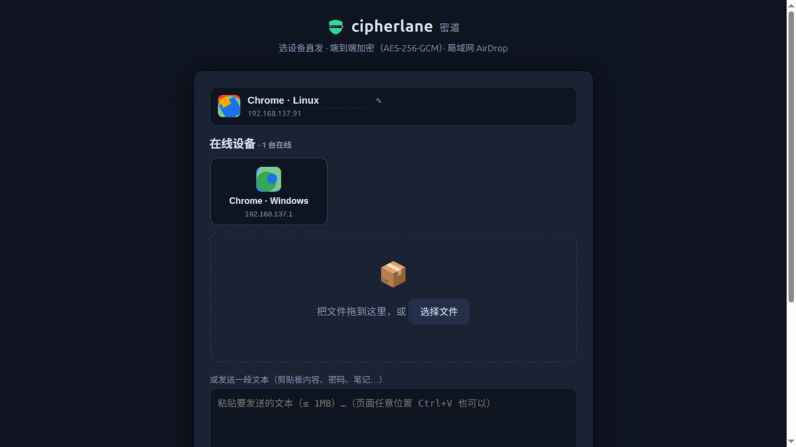
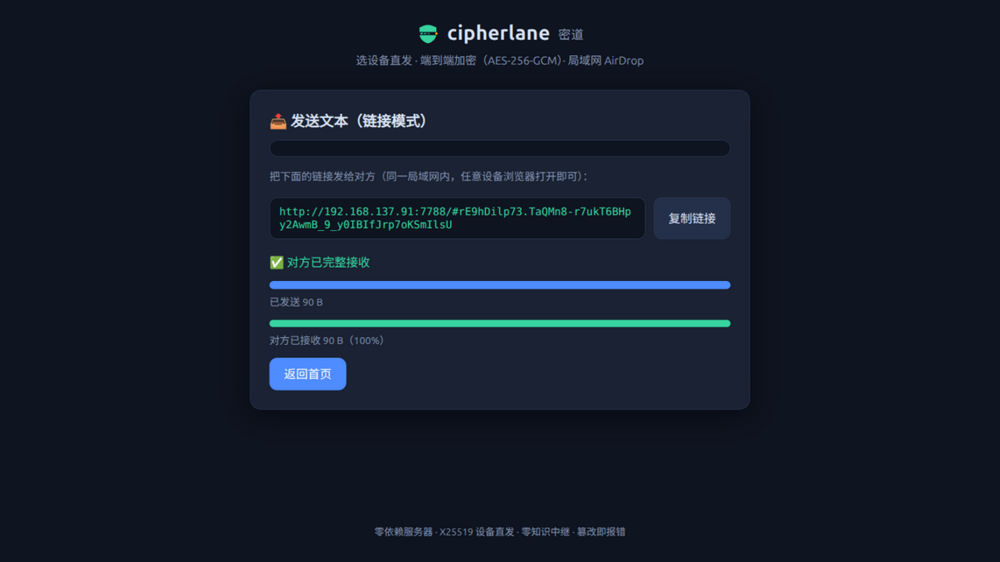
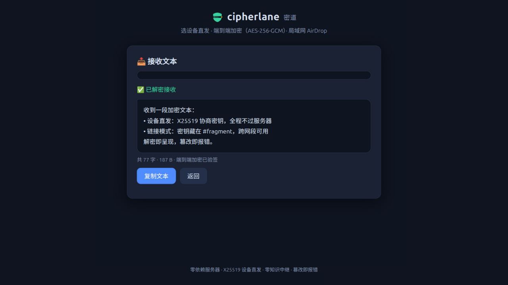

<div align="center">


# cipherlane

**End-to-end encrypted transfers on your LAN — an AirDrop for your local network**

Send device-to-device (X25519 key agreement) or via shareable links. Content stays encrypted even over plain HTTP.

English | [简体中文](README.zh-CN.md)

    

</div>

---

## Contents

- [Two Ways to Send](#two-ways-to-send)
- [Screenshots](#screenshots)
- [Quick Start](#quick-start)
- [How It Works & Protocol](#how-it-works--protocol)
- [Security Model](#security-model)
- [Packaging & Deployment](#packaging--deployment)
- [Browser Compatibility](#browser-compatibility)
- [FAQ](#faq)
- [Project Layout](#project-layout)
- [Tests](#tests)
- [Changelog](#changelog)
- [Roadmap](#roadmap)
- [License](#license)

## Two Ways to Send

| | Device Direct (default) | Link Mode |
| --- | --- | --- |
| Best for | Same LAN, pick & send | Across subnets / via chat apps or email |
| Key | X25519 negotiated inside both browsers, **never crosses the network** | Random key lives in the URL `#fragment`, delivered out of band |
| Passive sniffing / server logs | ✓ protected / ✓ protected | ✓ / ✓ |
| Malicious-server MITM | ✗ (public keys are distributed by the server — see [Security Model](#security-model)) | ✓ (key never reaches the server, fully zero-knowledge) |

One LAN IP = one device: each device gets a **name** (editable), a **geometric avatar** (deterministically generated from its IP, Material-flat style), and an **X25519 identity key** (kept in the browser's localStorage).

## Screenshots

| Device-direct home (online device grid + avatars) | Link mode, transfer done | Text receive (decrypt & display) |
| :---: | :---: | :---: |
|  |  |  |

`Ctrl+V` anywhere on the page sends your clipboard: screenshots/files go straight out, text goes directly if a device is selected (or fills the input box otherwise).

## Quick Start

```bash
node server.js            # or: npm start. Default port 7777 (PORT= to change);
                          # binds 127.0.0.1 + LAN (RFC1918) interfaces by default (HOST=0.0.0.0 for all interfaces)
```

The server prints its LAN address (e.g. `http://192.168.1.117:7777`). On any device on the **same Wi-Fi**, open it in a browser:

1. Set your name on the home page → the other side appears under "online devices"
2. Select a device → drop a file / paste text → the other side gets an invitation card (with the decrypted file name and size) → accept to receive

Machines without a browser can use the CLI (fully interoperable with the web UI):

```bash
node cli.mjs devices --server http://192.168.1.117:7777        # list online devices
node cli.mjs send big.zip --to 192.168.1.50 --server http://... # direct send (no link needed)
node cli.mjs listen --yes -o ~/downloads --server http://...    # resident receiver (can be direct-sent to)
node cli.mjs send big.zip --server http://...                   # link mode: prints a receive link
node cli.mjs send a.zip dir/ --server http://...                 # batch: multiple paths + recursive directories
node cli.mjs recv 'http://.../#ROOM.KEY' [-o output path]       # link-mode receive
```

## How It Works & Protocol

<details>
<summary>Architecture diagram (click to expand)</summary>

```
Sender browser/CLI                    LAN (plain HTTP, sniffable)             Receiver browser/CLI
┌─────────────┐  discovery/X25519 pub  ┌──────────────┐                     ┌─────────────┐
│ pick target  │ ◀─────────────────▶ │  dumb relay    │ ◀────────────────▶ │ picked from  │
│ ECDH → key   │    (sees only pubs)  │ sees only      │   (sees only pubs)  │ ECDH → key   │
│ AES-GCM enc  │ ──── ciphertext ───▶ │ ciphertext     │ ──── ciphertext ───▶ │ AES-GCM dec  │
└─────────────┘                      └──────────────┘                     └─────────────┘
   room key = SHA-256( X25519 shared secret ‖ both public keys ‖ room id ), derived identically on both sides
```

</details>

**Protocol at a glance** (all endpoints in `server.js`; limits are defaults):

| Endpoint | Purpose |
| --- | --- |
| `POST /api/presence` | Device heartbeat (last writer wins per IP, 5s heartbeat / 20s TTL) |
| `GET /api/devices` | Online device list (IP / name / X25519 public key) |
| `POST /api/rooms` | Create a transfer room (10-char base62 id ≈ 59.6 bits) |
| `POST /api/rooms/:id/chunk` | Post ciphertext chunk (1 MiB plaintext each, backpressure window 64, requires room token) |
| `GET /api/rooms/:id/chunk?i=N` | Sequential pull (25s long-poll, one-shot consumption) |
| `POST /api/rooms/:id/offer` | Attach a direct-send invitation (encrypted preview hint, must precede chunks) |
| `GET /api/offers` | Long-poll this device's pending invitations (**secret + source IP double binding**) |
| `POST /api/offers/:id/accept\|reject` | Accept / reject (rejected rooms live 2 more minutes for the sender to observe) |
| `POST /api/rooms/:id/done` / `ack` | Sender finished / receiver confirmed (ack carries a key proof verified locally by the sender); idle rooms are reclaimed after 15 min |

Limits: 64 chunks / 64 MB backpressure per room, 256 MB global, ≤ 8 pending offers per device (5 min TTL), ≤ 256 devices.

## Security Model

| Threat | Defense |
| --- | --- |
| LAN sniffing (plain HTTP) | Content, file names and types are all AES-256-GCM encrypted; every chunk is individually authenticated |
| The server operator (link mode) | Zero knowledge: the random key travels in the URL `#fragment`, peer to peer, and never reaches the server |
| The server operator (device direct) | Room key derived via X25519; the server sees only public keys and ciphertext — old logs stay useless |
| Stolen device secret | Useless: claiming an invitation requires **both the secret and the matching source IP** — a different machine gets 401 |
| Link obtained by a third party | Room ids are unenumerable; chunks are consumed one-shot — once someone pulls them, others get 410 |
| Tampering in transit | GCM auth tags verified per chunk; invitations whose preview fails verification are auto-rejected |
| Impersonating the sender | Posting chunks requires the random room token (held only in the sender's memory) |
| Forged delivery confirmation | ack carries a key proof SHA256(key‖label‖room); sender verifies locally and flags proof-less acks |
| Small-order / invalid public keys | X25519 all-zero shared secret is rejected (RFC 7748 requirement) |
| Room abuse | Hard limits above; idle rooms reclaimed automatically |

**Known boundaries (stated honestly)**:

- **Device-direct mode cannot automatically stop an active MITM by the server**: device public keys are distributed by the server, so a malicious server could substitute keys and impersonate the receiver. The mitigation is **public-key fingerprints** (TOFU): device cards and your own card show an 8-hex fingerprint, and a changed key is flagged "⚠ key changed" persistently — comparing fingerprints out loud defeats substitution, but the system will not compare them for you; the ↻ button on your card resets the identity key at any time. For the highest assurance, use link mode
- **The page itself is served over plain HTTP**: E2EE protects against passive observers only; an active on-path attacker could in principle replace the served JavaScript (the same class of risk as opening any plain-http site). Use a VPN on untrusted networks
- Device names and presence are visible to the server and to anyone who opens the page on the LAN — the inherent cost of device discovery
- The server binds 127.0.0.1 + LAN (RFC1918) interfaces by default, not VPN/tun or virtual adapters; explicit `HOST=0.0.0.0` (as the deb service template does) binds everywhere
- No resume support: chunks are consumed one-shot; if the receiver refreshes, the sender must resend
- Malicious packet dropping is DoS — detectable (stalled transfer / errors) but not preventable
- Room ids travel in plaintext HTTP requests: on fully sniffable networks an attacker can pull chunks (ciphertext they cannot decrypt) — in resumable rooms chunks are read-only, so stealing no longer starves the receiver; forging progress reports can still cut a transfer (availability-level, same class as before). Confidentiality is unaffected
- Multiple **different browsers** on one IP: the device entry belongs to the last one to register (same-browser tabs share the secret and coexist)

**How encryption works over plain http**: browsers only expose `crypto.subtle` in secure contexts. This project ships pure-JS implementations and degrades automatically: AES-256-GCM (`public/aesgcm.js`), SHA-256 (`public/sha256.js`), X25519 (`public/x25519.js`, BigInt + RFC 7748 Montgomery ladder). On localhost/https, AES uses native WebCrypto. The pure-JS output is byte-identical to node:crypto (verified by tests).

## Packaging & Deployment

One command produces installers for three platforms (target machines **do not need Node**):

```bash
sh build/package.sh            # artifacts in build/dist/
```

| Artifact | Platform | Install / use |
| --- | --- | --- |
| `cipherlane_<v>_amd64.deb` | Linux x64 (Ubuntu/Debian) | `sudo dpkg -i …deb && sudo systemctl enable --now cipherlane` (ships a systemd unit, starts on boot) |
| `cipherlane_<v>_windows_x64.zip` | Windows x64 | Unzip and double-click `cipherlane.exe` (console shows address + QR code) |
| `cipherlane_<v>_macos_universal.tar.gz` | macOS arm64 + x64 | Unzip and double-click `cipherlane.command` (if Gatekeeper complains: right-click → Open) |

Built on Node **SEA (single executable applications)**: the server and all frontend assets are embedded into official Node binaries per platform. Linux/Windows are true single files (125MB/87MB, 31MB/33MB compressed); macOS ships a dual-arch source bundle (75MB). The build script caches official binaries and postject, verifies downloads against SHASUMS256. **Naming convention**: artifacts are `cipherlane_<version>_<platform>.<format>`, checksums `cipherlane-<version>-SHA256SUMS.txt`, macOS inner runtimes `cipherlane-node-<arch>`; the startup banner and page footer both carry the version — quote it when reporting issues.

Source deployment stays zero-dependency: `node server.js` (Node ≥ 18).

## Browser Compatibility

| Requirement | Notes |
| --- | --- |
| BigInt (for X25519) | Chrome 67+ / Edge 79+ / Firefox 68+ / Safari 14+ |
| Streaming save (optional) | Chromium-based browsers support `showSaveFilePicker`; others fall back to in-memory download |
| Paste-to-send (optional) | Any modern browser with clipboard events; on mobile, long-press paste into the text box |

The CLI needs Node ≥ 18 (native X25519 and AES-GCM).

## FAQ

**The page still looks old after an upgrade / server restart?**
Static assets are loaded into memory at server start, and the browser may reuse an old tab — **close and reopen the tab** or hard-refresh (Ctrl+Shift+R).

**`EADDRINUSE: 7777` on startup?**
The port is taken. Start with `PORT=7788 node server.js`, or stop the old process.

**My phone can't see devices / others can't see me?**
All devices must be on the **same Wi-Fi/subnet**; check that the OS firewall allows the port (Windows asks once); make sure you opened the LAN address printed at startup, not `127.0.0.1` (loopback is local-only).

**Popups don't work in ZCode / Electron embedded browsers?**
Some embedded webviews lack `alert/confirm` and file savers — a host limitation. Use a real browser (Chrome / Edge / Safari) for serious work.

**QR code looks distorted in an IDE integrated terminal?**
IDE terminals (Electron/xterm.js) deviate from the standard 2:1 cell geometry, which can distort ASCII QR art — a rendering quirk of those environments; standard terminals (GNOME Terminal / Windows Terminal / iTerm) are fine. In an IDE terminal use the fallbacks: `cipherlane-qr-<pid>.png` in the system temp directory (pixel-exact; the banner prints the full path), or the SVG QR on the send page. `CIPHERLANE_QR_RATIO=<measured ratio>` corrects manually.

**Receiver refreshed mid-transfer of a big file?**
Link mode now resumes: reopen the same receive link (CLI: re-run the same command with the same output path) and it continues from the breakpoint. Device-direct and browser batch receive are not resumable yet — resend.

**The browser asks to "download multiple files" when receiving a batch?**
Memory mode triggers downloads one by one and the browser asks once for permission — allow it. Chromium browsers instead show a directory picker before receiving and stream straight into it, no prompt.

**How fast is the pure-JS path?**
Encryption runs in a ×4 worker pool; a single worker does ~22 MB/s (after T-table optimization), so 4 cores reach 80–90 MB/s — near gigabit line rate. localhost/https uses native WebCrypto and is faster. X25519 is milliseconds, imperceptible.

## Project Layout

```
cipherlane/
├── server.js           # zero-dependency relay: rooms + presence + invitations (Node builtins only)
├── cli.mjs             # CLI: devices / direct send / listen / link send & receive
├── sea-config.json     # SEA single-executable config (asset manifest)
├── build/package.sh    # one-shot packaging: .deb / Windows exe / macOS universal
├── logo/               # logo art (main + favicon master)
├── docs/screenshots/   # README screenshots
├── public/
│   ├── index.html      # SPA (device grid · geometric avatars · invitation cards · dual receive layouts)
│   ├── app.js          # send/receive logic + dual crypto paths + X25519 identity
│   ├── aesgcm.js       # pure-JS AES-256-GCM (plain-http fallback path)
│   ├── sha256.js       # pure-JS SHA-256 (KDF)
│   ├── x25519.js       # pure-JS X25519 (device-direct key agreement)
│   ├── avatar.js       # geometric avatars (Material-flat, deterministic from IP)
│   └── style.css
└── test/               # eight suites: aesgcm / sha256 / x25519 / qrcode / avatar / protocol / cli / browser
```

## Tests

```bash
npm test    # or run individually: node test/<name>.test.mjs
```

- **aesgcm**: FIPS-197 S-box vectors, GHASH cross-validation, byte-identical to node:crypto for 0B–1MiB
- **sha256**: FIPS 180-4 vectors + 500 random cross-checks
- **x25519**: RFC 7748 vectors + 200 random pairs vs node ECDH (both directions), small-order rejection
- **qrcode**: RS algebra self-checks, finder/timing/format structure assertions
- **avatar**: determinism, neighbor-IP distinctness, palette & luminance constraints
- **protocol**: spawns a real server; covers presence/invitations/accept/reject/limits/same-IP rotation/concurrent pulls/ack proofs/bind surface/link mode end to end
- **cli**: real-subprocess end-to-end — single file / recursive directory batch (nested · CJK names · empty files · hidden entries skipped) / mixed paths / text, byte-level comparison
- **browser**: CDP-driven real-Chrome smoke tests (two-page send/receive, error paths, worker-pool assertion); auto-skips when no browser is available

## Changelog

**v0.4.2** (2026-10-15)
- Performance: memory-mode checkpoint records and progress reports now flush together at 8-chunk (8MB) granularity. v0.4.0 rewrote the whole IDB array per chunk — cost grows linearly (measured 116ms/chunk at 100MB; ~10 minutes extrapolated for 1GB, overtaking crypto); the trade-off is re-pulling at most 8MB after a crash. FSA streaming mode is unaffected
- Resource profile (200MB over loopback, archived): relay throughput 109 MB/s (near gigabit line rate), server CPU 44%, idle RSS 76MB, peak 202MB during transfer, 43% of the increment returned after room reclamation (the rest is V8 heap deferred return — no accounting leak)

**v0.4.1** (2026-10-15)
- Device bar redesigned: wrapping grid → **single horizontal row + name/IP search** (search box appears above 6 devices, Enter selects the match) — with 15 devices the send area returns above the fold (measured 413px, down from ~1300px); desktop wheel scrolls horizontally on the row; heartbeat re-renders no longer reset scroll position; devices sorted by name (zh collation)
- Fixes: fixed 128px card width clipped the fingerprint tail (now content-driven, zero clipping by pixel assertion); returning to the landing page after receiving didn't refresh (late offers now render, devices refresh immediately, the stale `#ROOM.KEY` fragment is cleared from the address bar)
- Naming convention completed: checksums `cipherlane-<version>-SHA256SUMS.txt`, macOS inner runtimes `cipherlane-node-<arch>`; startup banner and page footer carry the version (package.json embedded into SEA so packaged binaries can read it)

**v0.4.0** (2026-10-13)
- Resume support (link mode; server stays zero-persistence, privacy model unchanged): chunks switch from consume-on-read to replayable — with `X-Resume` the room's GETs become read-only, and a new `POST /progress` endpoint frees buffers per the receiver's persisted position; backpressure window and memory bounds unchanged
- CLI: the `.part` file is the checkpoint (size aligned to chunk boundaries); re-running the same command after a kill resumes automatically; a mismatched link fails the first chunk's GCM check and restarts cleanly; progress is committed one chunk behind, eliminating the kill-race where reports outrun the disk
- Browser: IndexedDB checkpoint records (work on plain http too); Chromium file handles persist, re-authorized via the "continue receiving" button's gesture after reload; memory-mode parts land in IDB (disk-backed)
- Compatibility both ways: old clients omit `X-Resume` and get the original consume-on-read path; new clients against old servers silently degrade when progress 404s
- Bonus: resumable rooms are read-only, so chunk stealing no longer starves the receiver
- Tests: protocol 13 groups (+resumable semantics); CLI 5 groups (+SIGKILL-interrupt resume, byte-identical); browser 9 groups (+reload resume, asserts no re-fetch of completed chunks)

**v0.3.1** (2026-10-13)
- Pure-JS AES-256-GCM performance: AES core rewritten with T-tables (SubBytes + MixColumns fused into table lookups; single worker 9.3 → 22 MB/s, ×4 pool ≈ 80–90 MB/s, near gigabit line rate); GHASH moved from 4-bit to 8-bit windowed tables; streaming chunks with the same key reuse a key cache (rk32/H/tables built once)
- Byte-exactness unchanged: all existing node:crypto comparisons pass; new 100-round cross-check of the 8-bit tables against the reference multiply; the browser fallback-path scenario keeps verifying interop for real
- Trade-off note: T-tables have cache-timing side channels (require a co-located attacker continuously probing); this project's threat model is network attackers, acceptable on the plain-http fallback path

**v0.3.0** (2026-10-13)
- Multi-file / directory transfers: chunk 0 becomes an encrypted manifest (type:'batch'); each file's chunks stream sequentially in one room — zero server changes
- Browser: multi-select + "pick a folder" (directory tree flattened to relative paths); receivers on Chromium stream into a directory picker, others fall back to memory mode with sequential downloads; multi-file drops and pastes become batches
- CLI: `send` takes multiple paths and recurses directories (hidden dot-entries skipped, 256-file cap); `recv`/`listen` recreate the directory tree (per-segment path sanitization against traversal)
- New eighth suite cli.test: real-subprocess end-to-end (single/batch/mixed/text, byte-level + ack-proof loop); browser suite up to 8 groups (+ multi-file batch)

**v0.2.3** (2026-10-13)
- Hardening: per-IP concurrent long-poll cap of 8 (fd-exhaustion defense; legit traffic stays ≤4); the QR fallback PNG moved to the system temp directory with exclusive creation (the old fixed name in the working directory was a symlink-overwrite hazard); CLI chunk send/receive now retries stalled connections (same semantics as the browser)
- Identity-key reset (↻ on your card): manually rotate the X25519 identity; devices that sent to you before will see the "key changed" warning — closing the TOFU loop
- Tests: protocol suite at 12 groups (+ long-poll cap/release); browser suite at 7 (+ pure-JS AES fallback path — a host-mapped non-secure context receiving from a native-WebCrypto sender, byte-identical)

**v0.2.2** (2026-10-13)
- Adversarial-review fix batch: concurrent pulls of the same chunk are now first-come-first-served (runner-up gets 409; previously the sender got a 500 and the runner-up hung forever); setup-phase failures now have an escape path (previously a dead-end view with no button); per-transfer key scoping (concurrent send/receive in one tab no longer cross-contaminate); CLI short-read fix / dotfile defense (`.bashrc` lands as `bashrc`) / atomic `.part` writes
- Unique sequence numbers on chunk GETs: closes an in-flight request-coalescing hole where the browser/proxy could hand the same one-shot chunk to two waiters
- Performance: ×4 crypto worker pool (pure-JS AES scales with cores) + 3-deep receive prefetch pipeline
- Security: ack carries a key proof (forged acks detectable by the sender); device public-key fingerprints + change warnings (TOFU); default binding narrowed to loopback + LAN interfaces (no more default 0.0.0.0, avoids exposing VPN/tun segments)
- Engineering: zero-dependency browser smoke tests ×6 (CDP-driven Chrome — the frontend finally has automated tests); GitHub Actions CI (Node 18/20/22); packaging script checked in with supply-chain verification (SHASUMS256); deb systemd unit least-privilege hardened; stalled-connection timeouts; listen heartbeat warnings

**v0.2.1** (2026-10-12)
- QR codes: pure-JS encoder (V1–5 byte mode ECC-L, structural tests with RS algebra self-checks); SVG QR on the send page, ASCII QR in the server banner and CLI — scan with a phone and go
- Web Worker crypto: chunk encryption off the main thread (big transfers no longer stall the progress UI), one-chunk pre-encryption pipeline; automatic main-thread fallback
- Arrival alerts: system notifications (localhost/https) + tab-title flashing (anywhere) + mobile vibration

**v0.2.0** (2026-10-12)
- Device direct send: one IP = one device (name / geometric avatar / X25519 identity), pick-to-send, invitation cards, accept/reject
- Pure-JS X25519 + SHA-256 (RFC 7748 / FIPS 180-4, interop-tested against node natives)
- Separate text/file receive layouts; Ctrl+V anywhere to send
- Send-view terminal states fixed (return home on completion, 100% progress, rejection message no longer overwritten)
- CLI: `devices` / `--to` direct send / `listen` resident receiver
- Final logo "secret path on a shield", integrated into the header and favicon

**v0.1.0** (2026-10-11)
- Link-mode E2EE transfer: AES-256-GCM, zero-knowledge relay, pure-JS crypto fallback, CLI send/receive

## Roadmap

- [x] Pure-JS AES performance work (AES T-tables + 8-bit windowed GHASH + per-key caching; single worker 9.3 → 22 MB/s) — v0.3.1
- [x] QR codes for receive links (scan with a phone) — v0.2.1
- [x] Multi-file / directory transfers (manifest + sequential chunks in one room; folder picker / recursive CLI; browser ↔ CLI interop) — v0.3.0
- [x] Resume support (link mode): replayable chunks + receiver position reports free server memory; CLI resumes from the `.part` file, browsers from an IndexedDB record (FSA handles persistable). Device-direct (session keys never touch disk) and browser batch receive are not resumable yet — v0.4.0
- [x] Device public-key fingerprints + change warnings (TOFU defense against server MITM)
- [x] Hardening batch: long-poll concurrency cap, QR fallback image moved to the temp dir, CLI request timeouts, identity-key reset, pure-JS-path browser coverage — v0.2.3

## License

[MIT](LICENSE) © 2026 kgpche
