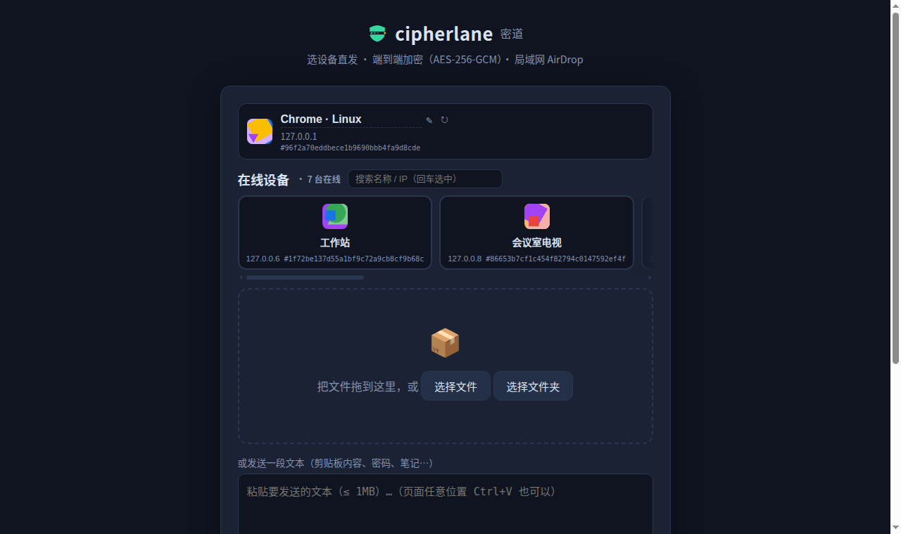
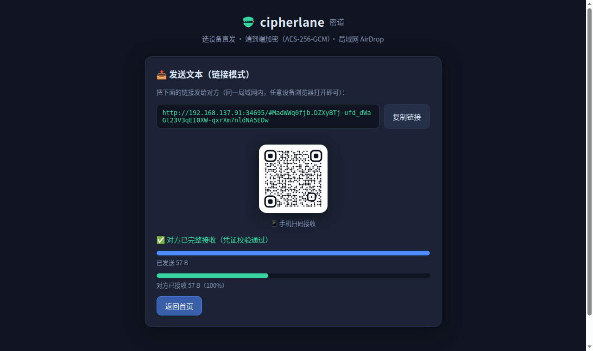
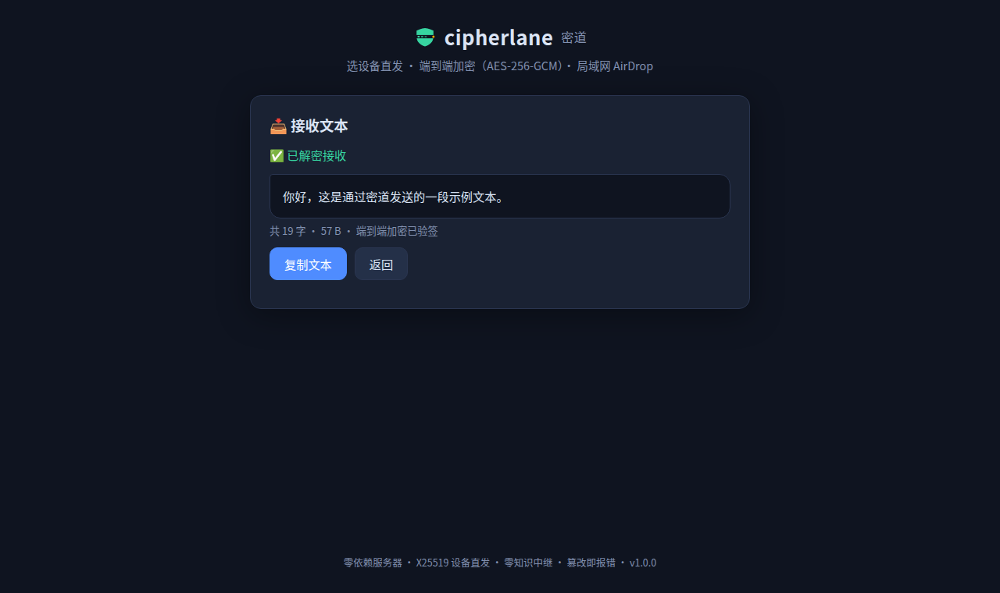

<div align="center">


# cipherlane · 密道

**局域网端到端加密传输 —— 局域网 AirDrop**

选设备直发（X25519 密钥协商）或链接收发，HTTP 明文环境下内容依然全程加密。

[English](README.md) | 简体中文

    

</div>

---

## 目录

- [两种发送方式](#两种发送方式)
- [截图](#截图)
- [快速开始](#快速开始)
- [打包与部署](#打包与部署多平台分发)
- [工作原理与协议](#工作原理与协议)
- [安全模型](#安全模型)
- [浏览器兼容性](#浏览器兼容性)
- [FAQ](#faq)
- [目录结构](#目录结构)
- [测试](#测试)
- [更新日志](#更新日志)
- [路线图](#路线图)
- [License](#license)

## 两种发送方式

| | 设备直发（默认） | 链接模式 |
| --- | --- | --- |
| 适用 | 局域网内，即选即发 | 跨网段 / 经微信、邮件发送 |
| 密钥 | X25519 在双方浏览器内协商派生，**永不过网** | 随机密钥藏于 URL `#fragment`，带外传递 |
| 防嗅探 / 防服务器翻日志 | ✓ / ✓ | ✓ / ✓ |
| 防服务器主动 MITM | ✗（公钥经服务器分发，见[安全模型](#安全模型)） | ✓（密钥不经服务器，完全零知识） |

一个局域网 IP = 一台终端：每台设备有**名称**（可改）、**几何头像**（由 IP 确定性生成，Material 扁平风）和 **X25519 身份密钥**（浏览器存 localStorage）。

## 截图

| 设备直发首页（单行设备栏 + 搜索 + 32hex 指纹） | 链接模式发送完成（二维码 + ack 凭证） | 文本接收（解密即呈现） |
| :---: | :---: | :---: |
|  |  |  |

页面任意位置 `Ctrl+V` 即可粘贴发送：截图/文件直接发，文本已选设备则直发、未选则填入输入框。

## 快速开始

安装对应平台的发行包（见[打包与部署](#打包与部署多平台分发)），或直接用 Rust 工具链从源码构建：

```bash
cargo build --release --manifest-path cipherlane-rs/Cargo.toml
./cipherlane-rs/target/release/cipherlane   # 默认端口 7777（PORT= 可改），默认只绑 127.0.0.1 与局域网网卡（HOST=0.0.0.0 恢复全网卡）
```

启动后打印局域网地址（如 `http://192.168.1.117:7777`）。其他设备连**同一 WiFi** 用浏览器打开：

1. 首页改好你的名字 → 对方出现在"在线设备"里
2. 点选设备 → 拖入文件 / 粘贴文本 → 对方页面弹出邀请卡片（含解密后的文件名与大小）→ 接受即收

无浏览器的机器用原生 CLI `cipherlane-cli`（与浏览器完全互通）：

```bash
cipherlane-cli devices --server http://192.168.1.117:7777        # 查看在线设备
cipherlane-cli send big.zip --to 192.168.1.50 --server http://... # 定向直发（无需传链接）
cipherlane-cli send big.zip --to 192.168.1.50 --verify 3f2a9c1b --server http://... # 核对目标指纹（防调包）
cipherlane-cli listen --yes -o ~/downloads --server http://...    # 常驻接收端（可被直发）
cipherlane-cli send big.zip --server http://...                   # 链接模式：打印接收链接
cipherlane-cli send a.zip dir/ --server http://...                 # 批量：多路径与目录递归（浏览器互通）
cipherlane-cli recv 'http://.../#ROOM.KEY' [-o 保存路径]           # 链接模式接收
```

## 工作原理与协议

<details>
<summary>架构图（点开）</summary>

```
发送方浏览器/CLI                      局域网（HTTP 明文可被嗅探）              接收方浏览器/CLI
┌─────────────┐   设备发现/X25519公钥  ┌──────────────┐                     ┌─────────────┐
│ 选目标设备   │ ◀─────────────────▶ │  哑中继服务器  │ ◀────────────────▶ │ 在线列表被选中 │
│ ECDH 派生密钥 │     （只见公钥）      │  只见密文与流量 │    （只见公钥）      │ ECDH 派生密钥 │
│ AES-GCM 加密 │ ──── 密文分片 ────▶ │  邀请/中转/背压 │ ──── 密文分片 ────▶ │ AES-GCM 解密 │
└─────────────┘                     └──────────────┘                     └─────────────┘
     房间密钥 = SHA-256( X25519 双方私钥协商 ‖ 双方公钥 ‖ 房间号 )，两侧独立算出、一致
```

</details>

**协议一览**（全部端点见 `cipherlane-rs/src/main.rs`，限额为默认值）：

| 端点 | 作用 |
| --- | --- |
| `POST /api/presence` | 设备心跳注册（同 IP 最后写入者生效，5s 心跳 / 20s TTL） |
| `GET /api/devices` | 在线设备列表（IP / 名称 / X25519 公钥） |
| `POST /api/rooms` | 创建传输房间（房间号 10 位 base62 ≈ 59.6 bit） |
| `POST /api/rooms/:id/chunk` | 投递密文分片（1 MiB 明文/片，背压窗口 64 片，需 room token；可选 `X-Chunk-Seq` 幂等序号，超时重投不重复入库） |
| `GET /api/rooms/:id/chunk?i=N` | 顺序拉取（25s 长轮询，一次性消费） |
| `POST /api/rooms/:id/offer` | 挂载定向邀请（加密预览 hint，须在投递分片之前） |
| `GET /api/offers` | 长轮询本机待处理邀请（**secret + 来源 IP 双重绑定**） |
| `POST /api/offers/:id/accept\|reject` | 接受 / 拒绝（拒绝后房间保留 2 分钟供发送方观测） |
| `POST /api/rooms/:id/done` / `ack` | 发送完毕 / 接收确认（ack 附密钥凭证，发送方本地校验）；房间空闲 15 分钟自动回收 |

限额：单房间 64 分片 / 64 MB 背压，全局 256 MB，单 IP 64 房 / 96 MB 滞留密文 / 120 建房每分钟，单设备待处理邀请 ≤ 8（TTL 5 分钟），设备表 ≤ 256。

**协议 v2（v0.5.0+）**：每个分片以 `AAD = cipherlane/chunk/v2|<房间号>|<序号>` 绑定位置，重排、重放或错位分片会被 GCM 拒绝；接收端在完成时校验明文总长度（文本/每个文件/总量），不一致即失败且不发送 ack。v0.5.0 发送的传输**不能被 v0.4.x 接收端解密**（两端需同时升级）；新接收端仍兼容旧发送端（先试 v2、失败回退 v1）。v0.5.1 起分片投递可带 `X-Chunk-Seq` 幂等序号（可选、向后兼容）：客户端超时/背压重投复用同一序号，服务端只认一次，不会重复入库或错位。

## 安全模型

| 威胁 | 防护 |
| --- | --- |
| 局域网嗅探（明文 HTTP） | 内容、文件名、类型全部 AES-256-GCM 加密，密文分片独立验签 |
| 运行服务器的人（链接模式） | 零知识：随机密钥经 URL `#fragment` 点对点传递，永不到达服务器 |
| 运行服务器的人（设备直发） | 房间密钥由 X25519 协商派生，服务器只见公钥与密文，事后翻日志无法解密 |
| 偷走设备 secret | 无效：领取邀请需 **secret 与来源 IP 同时匹配**，换台机器即 401 |
| 链接被无关者拿到 | 房间号不可枚举；分片顺序一次性消费，一人取走他人即 410 |
| 传输中被篡改 | GCM 认证标签逐分片校验，AAD 绑定房间与分片序号；完成后校验明文总长度；邀请预览验签失败自动拒绝 |
| 冒充发送方投毒 | 投递分片需持有随机 room token（仅发送方持有；HTTP 明文链路上可被嗅探，故传输仍依赖 GCM 认证） |
| 伪造接收确认 | ack 携带密钥凭证 SHA256(key‖标签‖房间号)，无密钥者伪造的 ack 发送方一辨即明 |
| 小阶点 / 无效公钥攻击 | X25519 共享密钥全零即拒绝（RFC 7748 要求） |
| 房间/内存滥用 | 单房间 64MB、全局 256MB、单 IP 64 房/96MB/120 建房每分钟，超限 429，空闲自动回收 |

**已知边界（如实说明）**：

- **设备直发无法自动防服务器主动 MITM**：设备公钥由服务器分发，恶意服务器理论上可调包公钥冒充接收方。防线是**公钥指纹**（TOFU）：设备卡/名片显示 **128bit（32 hex）** 指纹，公钥变化会持续标"⚠ 公钥已变化"；设备直发与收到的邀请在公钥变化时都会强制二次确认，CLI 用 `--verify <指纹前缀>` 可强制校验——双方口头比对指纹可识破调包，但系统不会替你比对；名片上的 ↻ 可随时重置身份密钥。极高安全需求请用链接模式
- **页面本身经明文 HTTP 下发**：端到端加密只防被动嗅探；路径上的主动攻击者理论上可替换下发的 JS（与浏览器打开任何 http 站点同级的风险）。不可信网络请配合 VPN 使用
- 设备名称与在线状态对服务器及局域网内打开页面的用户可见——这是"设备发现"的固有代价
- 服务默认只绑 127.0.0.1 与局域网（RFC1918）网卡，不绑 VPN/tun、虚拟网卡等非信任网段；deb 服务模板同样按此默认，确有全网卡需求时用 systemd drop-in 覆盖 `HOST=0.0.0.0`
- `/api/*` 会校验 Host 与 Origin（防 DNS rebinding 与跨站 CSRF）；若通过自定义域名（反向代理、mDNS、hosts 别名）打开页面，需用 `CIPHERLANE_EXTRA_HOSTS=<域名1>,<域名2>` 放行，否则页面能打开但 API 返回 403
- 链接模式接收支持断点续传（服务端分片可重放 + 进度释放；浏览器用 IndexedDB、CLI 用 `.part` 定位断点）；设备直发模式与浏览器多文件批量接收不支持，刷新后需发送方重发
- 恶意丢弃流量属于 DoS，可检测（传输卡住/报错）但无法防止
- 房间号在 HTTP 请求中明文过线：可完整嗅探的网络上攻击者可拉取分片（拿到密文、无法解密）——可续传模式下分片只读，抢拉不再饿死接收方；但伪造进度上报可释放缓存造成断流（可用性攻击，与既往同级的已知边界）。保密性不受影响
- 同一 IP 多个**不同浏览器**同时在线时，设备条目以后注册者为准（同浏览器多标签已通过共享 secret 解决）

**技术上如何做到 http 下也能加密**：浏览器 `crypto.subtle` 只在安全上下文存在。本项目自带纯 JS 实现，非安全上下文自动降级：AES-256-GCM（`public/aesgcm.js`）、SHA-256（`public/sha256.js`）、X25519（`public/x25519.js`，BigInt + RFC 7748 Montgomery 阶梯）；localhost/https 下 AES 走原生 WebCrypto。纯 JS 与原生 Rust 实现逐字节一致（由 Rust 测试保证）。

## 打包与部署（多平台分发）

每个平台一条命令产出发行物；目标机器**无需安装任何运行时**（原生 Rust 二进制，前端在编译期内嵌）：

```bash
sh build/package.sh            # 产物在 build/dist/（在 Linux / macOS / Windows Git Bash 中各自原生运行）
```

| 产物 | 平台 | 安装/使用 |
| --- | --- | --- |
| `cipherlane_<v>_amd64.deb` | Linux x64（Ubuntu/Debian） | `sudo dpkg -i …deb && sudo systemctl enable --now cipherlane`（自带 systemd 单元、桌面入口、托盘自启；安装 `cipherlane` / `cipherlane-cli` / `cipherlane-tray`） |
| `cipherlane_<v>_windows_x64.zip` | Windows x64 | 解压后双击 `cipherlane.exe`（控制台显示地址与二维码）；`cipherlane-cli.exe` 为命令行 |
| `cipherlane_<v>_macos_universal.tar.gz` | macOS arm64 + x64 | 解压后双击 `cipherlane.command`（首次若被 Gatekeeper 拦截：右键→打开）；`cipherlane-cli` 为命令行 |

**三平台是同一套 Rust 实现**——服务器、CLI 与（Linux）系统托盘；网页前端经 `include_bytes!` 编译进服务器，一个静态二进制即提供全部功能，构建与运行都不依赖 Node。Linux 为 musl 静态产物（服务器 ≈0.95MB、托盘 ≈2.3MB、deb ≈1.3MB）；Windows zip 与 macOS 通用包为原生 release 构建，具体体积由发布工作流实测输出。每次打包都会生成 `cipherlane-<版本>-SHA256SUMS.txt`；打 tag 发布时工作流会汇总统一校验和并随三平台产物一起上传。**命名规范**：产物统一 `cipherlane_<版本>_<平台>.<格式>`；启动横幅与页面 footer 均带版本号，报问题时直接引用。

纯源码构建只需 Rust 工具链：`cargo build --release --manifest-path cipherlane-rs/Cargo.toml`。

## 浏览器兼容性

| 要求 | 说明 |
| --- | --- |
| BigInt（X25519 需要） | Chrome 67+ / Edge 79+ / Firefox 68+ / Safari 14+ |
| 流式保存（可选） | Chromium 系支持 `showSaveFilePicker`；其他浏览器自动回退内存模式下载 |
| 粘贴发送（可选） | 支持剪贴板事件的现代浏览器；移动端长按粘贴进文本框即可 |

CLI 为原生二进制（`cipherlane-cli`），无需任何运行时。

## FAQ

**改版 / 重启服务器后页面还是旧样子？**
静态资源在服务器启动时读入内存，浏览器也可能复用旧标签页——**关掉标签重开**或强制刷新（Ctrl+Shift+R）。

**启动报 `EADDRINUSE: 7777`？**
端口被占用。`PORT=7788 ./cipherlane` 换端口（源码构建），或改 systemd 单元里的 `PORT`，或找到占用的旧进程停掉。

**手机上看不到设备 / 别人看不到我？**
必须连**同一个 WiFi / 网段**；首次使用注意系统防火墙是否放行了端口（Windows 会弹一次询问）；确认打开的是启动时打印的局域网地址而不是 `127.0.0.1`（回环只有本机能访问）。

**在 ZCode / Electron 等嵌入式浏览器里弹窗不生效？**
部分嵌入式 webview 的 `alert/confirm` 与文件保存器不可用，属宿主限制。正式使用建议系统浏览器（Chrome / Edge / Safari）。

**ZCode / IDE 集成终端里二维码显示异常？**
IDE 集成终端（Electron/xterm.js）的字符行高与字形度量偏离标准 2:1，字符艺术二维码可能变形——这属于该环境的渲染特性，标准终端（GNOME Terminal / Windows Terminal / iTerm）显示正常。集成终端里请用两条保底路径：系统临时目录下的 `cipherlane-qr-<pid>.png`（像素精确，启动横幅会打印完整路径），或网页发送页的 SVG 二维码。也可用 `CIPHERLANE_QR_RATIO=<实测比例>` 手动校正（太高调小、太宽调大）。

**发大文件接收方刷新了页面怎么办？**
链接模式已支持断点续传：重新打开同一接收链接（CLI 重跑同一命令、输出路径不变），自动从断点继续。设备直发与浏览器批量接收暂不支持，需重发。

**批量接收时浏览器提示"下载多个文件"？**
内存模式下逐个触发下载，浏览器会请求一次"允许下载多个文件"，点允许即可；Chromium 系在接收前弹目录选择器直接流式写入，无此提示。

**纯 JS 降级路径速度如何？**
明文 http（`http://<局域网 IP>`）是非安全上下文，加解密走纯 JS AES：单个 worker 约 17 MiB/s，页面让 3 片同时在途，实测接收约 32 MiB/s、发送约 30 MiB/s（100MiB 文件，headless Chrome 158，开发机实测值）。localhost / https 下走原生 WebCrypto，内存模式接收约 55–65 MiB/s。X25519 为毫秒级，无感。

## 目录结构

```
cipherlane/
├── cipherlane-rs/          # 全部产品 + Rust 测试套件
│   ├── Cargo.toml          # 版本号 + 三个 bin（cipherlane / cipherlane-cli / cipherlane-tray）
│   ├── src/
│   │   ├── main.rs         # 中继服务器（房间/在线/邀请）+ 编译期内嵌网页前端
│   │   └── bin/            # cli.rs（cipherlane-cli）· tray.rs（cipherlane-tray，仅 Linux）
│   └── tests/              # Rust 套件：crypto / protocol / cli / browser / consistency
├── public/                 # 浏览器前端（原生 JS；纯 JS 加密用于明文 HTTP 降级路径）
│   ├── index.html          # 单页应用（设备网格 · 几何头像 · 邀请卡片 · 双接收布局）
│   ├── app.js              # 收发逻辑 + 双加密路径 + X25519 身份
│   ├── aesgcm.js           # 纯 JS AES-256-GCM（http 降级路径）
│   ├── sha256.js           # 纯 JS SHA-256（密钥派生 KDF）
│   ├── x25519.js           # 纯 JS X25519（设备直发密钥协商）
│   ├── avatar.js           # 设备几何头像（Material 扁平风，由 IP 确定性生成）
│   └── style.css
├── build/package.sh        # 一键打包：.deb / Windows zip / macOS 通用包
├── logo/                   # Logo：盾上密径（主图 + favicon 小尺寸母版）
└── docs/screenshots/       # README 截图
```

## 测试

包括浏览器套件在内，全部测试都由 `cargo test` 运行；**仓库没有任何 Node 依赖**。浏览器前端是原生 JS（浏览器自己的语言），由 Rust 测试通过 CDP 驱动真实无头 Chrome 验证。

```bash
cargo build --release --manifest-path cipherlane-rs/Cargo.toml                    # release 构建
cargo test  --release --manifest-path cipherlane-rs/Cargo.toml                    # 全部套件
cargo test  --release --manifest-path cipherlane-rs/Cargo.toml --test protocol    # 单个套件：crypto / protocol / cli / browser / consistency
cargo test  --release --manifest-path cipherlane-rs/Cargo.toml --test screenshots -- --ignored  # 重新生成 docs/screenshots（需 Chrome）
```

- **crypto**：迁移 FIPS 197 / FIPS 180-4 / RFC 7748 标准向量与随机交叉（AES-256-GCM 含 AAD、SHA-256、X25519、二维码、头像）；期望值由 RustCrypto 计算
- **protocol**：驱动真实 Rust 服务器二进制，覆盖在线/邀请/接受/拒绝/上限/同 IP 轮换/并发拉取/ack 凭证/ETag/Host 校验/链接模式全链路（CI 另对 musl 发布二进制直跑）
- **cli**：真实子进程端到端——`cipherlane-cli` ↔ Rust 服务器：单文件/目录递归批量（嵌套·中文·空文件·隐藏项跳过）/多路径混合/文本/SIGKILL 续传，字节级比对
- **browser**：Rust CDP 客户端驱动真实无头 Chrome 的端到端冒烟（双页收发、错误路径、Worker 池断言）；无 Chrome 时自动跳过
- **consistency**：README 徽章 ↔ `Cargo.toml` 版本、`include_bytes!` ↔ `public/`、必需 bin 与测试目标，以及对产品代码/构建脚本/CI/README 命令块的零 Node 守卫

## 更新日志

**v1.0.0**（2026-10-20，单一实现）
- **产品与测试彻底去 Node**：服务器、CLI、托盘与全部测试合并为同一套 Rust 实现；Node 版中继/CLI、Node 单文件可执行打包链与 Node 测试运行器全部移除；浏览器前端保持原生 JS，由 Rust 测试通过 CDP 驱动 Chrome 验证
- **测试也 Rust 化**：crypto / protocol / cli / browser / consistency 五套全部由 `cargo test` 运行，浏览器套件是 Rust CDP 客户端驱动真实 Chrome；仓库不再有 Node
- **原生 Rust CLI** 完整替代 Node CLI：子命令与选项不变（`devices` / `send` / `send-text` / `recv` / `listen`；`--to`、`--verify`、`--name`、`--server`、`-o`、`--yes`），支持协议 v2 AAD 与 v1 回退、链接模式断点续传、批量/目录递归、128bit TOFU 指纹与控制字符净化
- **三平台 Rust 原生产物**：Linux deb（musl 静态 server/tray/cli，≈1.3MB）、Windows x64 zip（`cipherlane.exe` + `cipherlane-cli.exe`，静态 CRT）、macOS 通用 tar.gz（`lipo` 合并 arm64+x64）——不再有 Node、二进制注入等步骤
- **发布自动化**：推送 `v*` 标签即由 GitHub 官方 runner 三平台原生构建，并用官方 `gh` CLI 发布产物与统一 SHA256SUMS；手动触发只构建 artifact 不发布
- **CI**：Rust 三 bin 构建 + `cargo test`（crypto / protocol / CLI / browser / consistency）+ musl 协议平价 + deb 打包冒烟（断言三 bin 与维护脚本齐全）；Windows/macOS 编译门禁前置到普通 push/PR，CI 强制要求 Chrome（`CIPHERLANE_REQUIRE_CHROME=1`，前端覆盖不许静默清零）；发版前校验 tag 与 Cargo.toml 版本一致；一致性守卫本身也是 Rust 测试，校验版本、`include_bytes!` 资源与零 Node 残留
- **服务端连接层加固**（v1.0 收口）：vendor 补丁版 tiny_http——请求头 16KiB 预算、每连接 60s 读/写超时、并发连接上限 256（对齐旧 JS 运行时的默认防护，堵住 slowloris 面）；真·优雅停机（停止派发 → 250ms 排干在途请求 → exit 0，SIGTERM/面板停机同路径）；worker panic 隔离（catch_unwind）与锁毒化恢复，单请求异常不再级联；`/api/update` 支持 https（rustls，纯 Rust TLS）与 ≤3 次重定向、响应上限 64KiB、单飞等待有界；设备/建房/字节配额三处并发窗口收口（检查与入账同一临界区）；静态资源 Arc 化零拷贝回源
- **TOFU 重信闭环**（前端修复）：设备公钥变化（如对方重置身份密钥）时"⚠ 公钥已变化"警示
  常驻，但此前的"我已核对"确认只放行单次发送/接收、不回写新公钥——红条永不消除且每次都
  重复弹确认。现在两条确认路径（直发/邀请接受）核对通过后即以新公钥为基准重信：红条消除、
  后续不再打扰，再次变化仍会警示；配套 browser 回归 t16（含真实服务端邀请的接受路径）
- **入口职责划分收口**（桌面/托盘/服务三层归位）：应用列表点 cipherlane 打开的应是
  **传输主页**且必须开局域网地址（曾固定开 `http://127.0.0.1:7777`——链接/二维码早已
  升级 LAN，唯独启动器漏了；回环与 LAN 两个 origin 还会把浏览器裂成两个身份）；
  **管理面板只在回环打开、只经托盘进入**。启动器改为无令牌启动服务（留给托盘 adopt
  接管，旧随机令牌会让托盘 409 变只读——"托盘功能消失"的根源）；托盘轮询在服务
  出现时主动接管；deb 升级自动恢复之前在跑的服务（prerm 记录、postinst 拉回）。
  多网卡时 lan 提示固定取**默认路由网卡**地址（/proc/net/route），不再随接口枚举顺序
  漂移——多网段机器上链接时对时错的根源
- **修复：浏览器批量接收越过背压窗口即卡死**：页面拉分片恒带 `X-Resume`（只读回放、不释放），
  而批量接收从不上报进度——发送方投满服务端 64 片窗口后被永久 429，接收方又在等下一片，
  双方停在约 63MiB 互等（链接模式与设备直发均中招，CLI 做接收端不受影响）。现在整批放不进
  窗口时，每落定一个文件就上报进度、放行它占用的分片；能整批塞进窗口的批量不报进度，行为
  与以往一致（刷新后仍可整批重拉）。browser 回归 t17（70 片批量流式落盘）
- **修复：残留房间占着 per-IP 字节配额**：传输结束后房间要等空闲清扫（ack 后 2 分钟、无人
  接收 15 分钟），这期间滞留密文一直算在发送方 IP 的 96MiB 配额里，同一台机器的下一次大文件
  发送会被背压卡住且没有任何报错。现在发送方（浏览器与 CLI）在观测到带有效凭证的 ack、
  拒绝、中断或失败后立即删除房间，浏览器页面真正卸载时也经 `beforeunload` 删除在途房间；
  没有有效凭证的 ack（可能是伪造）不删，保留服务端宽限。browser 回归 t18 + CLI 断言
- **空闲 CPU 降到约 1/10**：长轮询挂起期间每 100ms 整读一遍 `/proc/net/tcp` 做断连检测
  （台式机实测每次约 3.5ms；每个打开的页面常驻一条邀请长轮询，每条挂起连接约占 3.6% 单核）。
  检测周期放宽到 1s（同一时刻 A/B，16 条挂起长轮询：58–60% → 6%）；代价是客户端断开后
  worker 线程与 per-IP 长轮询配额最多多占 1s 才释放
- **测试基建**：浏览器套件显式拒绝页面触发的下载（旧版 headless Chrome 会把测试文件落进
  `~/Downloads`）；新增回归 t17 / t18
- **性能：明文 http 路径收发提速约 2 倍**：页面在 `http://<局域网 IP>` 下是非安全上下文，加解密
  走纯 JS AES，而调用方式是一次只等一片——4 个 worker 里只有 1 个在干活。收发两端现在各保持
  3 片"读切片 / 拉取 + 加解密"在途，与写盘 / 投递重叠。实测（100MiB，headless Chrome 158，
  开发机）：纯 JS 接收 15.6 → 32 MiB/s，纯 JS 发送 17.7 → 30 MiB/s，两端都是纯 JS 的内存模式
  接收 9.7 → 25 MiB/s。深度取 3 是上限：同一浏览器里同时开发送页与接收页时，浏览器的
  6 条每主机连接正好用满，取 4 会死锁（已实测）
- **性能：内存模式断点改为按段追加**：旧布局每个检查点把"到目前为止的全部分片"整条重写进
  IndexedDB，耗时随文件大小平方增长（400MiB：57s，关掉断点只要 5s）。现在断点记录不含分片
  本体，每 8 片只追加一段（同一事务里更新记录）：400MiB 约 7s，与关掉断点相当
- **修复：续传没接上时静默损坏文件**：流式续传的原文件句柄失效（文件被移走 / 删除，或授权被拒）
  时会回落到重新选保存位置，但断点没有归零——新的空文件从第 9 片的位置开始写，开头留一段空洞，
  而总长度仍然对得上，完整性校验发现不了。现在从头重收：分片还在就完整重收，已释放则明确报错、
  让发送方重发（browser 回归 t20）
- **修复：放弃的断点记录永不清理**：房间已不在服务器上的记录永远续不上，却一直占着 IndexedDB
  （内存模式下就是已下载的那部分文件）。现在页面启动时清理这类记录，分片段与旧布局记录一并
  删除，房间仍在的记录保留（browser 回归 t21）。同时补上 IndexedDB 事务的 abort 处理：此前
  "只有 abort、没有 error"的中止会让接收流水线永远停在检查点上
- **测试**：新增明文 http 主路径的多分片用例（纯 JS AES + worker 池 + 内存模式，21 片，页面内
  SHA-256 逐字节比对，t19）；修复 t06 的偶发失败（约 1/6：页面启动那一轮还在途的设备刷新把
  注入的测试设备覆盖掉）
- **修复：页面偶发一直停在加载中**（Rust 版 CI 首跑时暴露）：vendored tiny_http 上游的
  连接任务池有一个丢唤醒竞态——"已被唤醒、还没回到取任务循环"的线程仍被算作空闲，浏览器
  并发建立 6 条连接时，第 5、6 条连接的任务被塞进队列却没人认领：连接已被接受、请求
  一直没人读，页面缺一两个静态资源停在 loading，直到别的连接关闭才恢复。核越少越容易
  撞上（整机 4 核时实测约 1/4 的页面加载中招；回环与局域网地址都会）。空闲线程改为
  "先预约再唤醒"的计数方式（vendor 补丁 4）。回归 g28（直接驱动任务池，上游实现下必
  失败）与 g27（真实服务器的突发连接）；browser 套件钉在 4 核上连跑 6 次全绿（修复前
  每次都有页面加载超时）
- **CI**：Windows 的"编译测试目标"此前因 `screenshots` 套件用到 unix 专有接口而失败；
  连同 g26（SIGTERM）一起按 unix 门控，全部测试目标对 Windows / macOS 做了交叉类型
  检查（零错误零警告）。注意 Windows / macOS 目前仍然只验证"能编译"，没有真跑过测试
- **修复：macOS 发行包打不出来**（Release 工作流首次空跑时暴露）：`build/package.sh` 里
  "变量名后紧跟全角括号 / 中文逗号"的写法在 macOS 自带的 bash 3.2 下会把后面的字节并进
  变量名，`set -u` 直接报 unbound variable；Linux 的 dash / bash 5 上完全正常，所以普通
  CI 发现不了（macOS 只在 Release 工作流里跑打包脚本）。相关写法一律改为 `${变量名}`，
  并由 consistency 套件守住
- **文档**：README（中/英）与迁移文档按 Rust 单实现重写

**v0.5.1**（2026-10-19，可靠性）
- **分片投递幂等**：新增可选 `X-Chunk-Seq` 头；浏览器/CLI 的超时与背压重投复用同一序号，
  服务端只接受一次，杜绝"响应丢失后重投"造成的重复分片/错位；Node 与 Rust 服务端同构
  （彼时双实现并存；v1.0 起仅剩 Rust 实现）
- **前端可靠性**：API/心跳/邀请/状态轮询统一超时并防重入；邀请列表按服务端全量对账、
  清空后停止标题闪烁；设备列表差量渲染（不再每 5s 重建丢焦点）；同一时刻仅一路接收
- **测试**：protocol 26 组（其中 17 组同时跑 Rust 服务端平价）、browser 19 组、cli 10 组

**v0.5.0**（2026-10-19，安全强化）
- **协议 v2**：AES-GCM 分片加入 AAD 位置绑定（房间号 + 分片序号），重排/重放/错位分片被
  GCM 拒绝；接收端完成时校验明文总长度（文本/每个文件/总量），不一致不 ack。v0.5.0 发送端
  与 v0.4.x 接收端不兼容（需双端同时升级）；新接收端仍兼容旧发送端
- **TOFU 指纹升级为 128bit（32 hex）**，设备直发与收到的邀请在公钥变化时强制二次确认；
  CLI 展示指纹并支持 `--verify <前缀>` 强制校验，同时过滤远端字符串的控制字符（防终端注入）
- **服务端加固**：`/api/*` 校验 Host/Origin（防 CSRF/DNS rebinding）；per-IP 房间/字节/建房
  速率配额（64 房 / 96MB / 120 次每分钟）；常量时间令牌比较；`/api/update` 5 分钟缓存 +
  语义化版本比较；设备名控制字符过滤；SIGTERM 优雅停机
- **性能/可靠性**：静态资源 ETag/304 回源校验（HTML 仍 no-store）；413 真实可达；分片 head
  仅在按序时推进；FSA 流式保存真正启用并支持刷新续传；房间销毁期间到达的写请求回 410
  （修全局内存计数泄漏）；Rust 版背压计数竞态与房间销毁泄漏修复
- **打包**：Linux deb 改用 musl 静态托盘（不再依赖 GLIBC_2.39）；systemd 默认仅绑回环+LAN
- **工程**：CI 增加 Rust 构建与协议平价、版本/内嵌资源一致性检查；仓库移除误入库的
  800MB Rust 构建产物

**v0.4.3**（2026-10-15，热修）
- 修复：自定义 `display`（flex/grid）会压过浏览器默认的 `[hidden]{display:none}`，
  导致 hidden 属性失效——全局盘点共 6 处中招：v0.4.1 新增的确认弹窗遮罩
  **每次刷新都全屏弹出**（空标题空正文），另有 5 处历史存量（发送目标行/
  二维码区/接收来源行/文件卡/操作按钮组）以空盒子形式错显。加入
  `[hidden]{display:none!important}` 防御性复位一行根治
- 测试基建吸取教训：hidden 断言此前查 DOM 属性（测不出本类 bug），改为
  **计算样式不变量**（所有 [hidden] 元素 display 必须为 none），两处场景落地；
  身份重置场景冻结同 IP 兄弟页面消除设备条目竞态

**v0.4.2**（2026-10-15）
- 性能：内存模式断点记录与进度上报按 8 片（8MB）粒度对齐落盘。v0.4.0 逐片
  重写整条 IDB 数组，耗时随片数线性增长（实测 100MB 时每片 116ms，1GB 外推
  约十分钟，会反超加密耗时）；代价为崩溃后最多重拉 8MB。FSA 流式模式不受影响
- 资源画像（200MB 回环实测存档）：中继吞吐 109 MB/s（近千兆线速），服务器
  CPU 44%，空闲 RSS 76MB，传输峰值 202MB，房间回收后增量回落 43%（其余为
  V8 堆延迟归还，无记账泄漏）

**v0.4.1**（2026-10-15）
- 设备栏重排：换行网格 → **单行横滑 + 名称/IP 搜索**（>6 台出现搜索框，回车选中
  匹配设备）——15 台设备时发送区从 1300px 外回到首屏（实测 413px）；桌面滚轮
  悬停转横滑，心跳重渲染不打断横滑位置；设备按名称本地化排序（zh 拼序）
- 修复：卡片定宽 128px 裁掉指纹尾巴（改内容自适应，像素级断言零裁切）；
  接收后返回首页不刷新（延迟邀请补画 + 设备即时刷新 + 地址栏残留接收链接清除）
- 命名规范补全：校验和 `cipherlane-<版本>-SHA256SUMS.txt`；启动横幅与页面 footer
  带版本号（版本号编译期内嵌，打包二进制可读）

**v0.4.0**（2026-10-13）
- 断点续传（链接模式，服务端零持久化，隐私模型不变）：
  分片从"取走即焚"改为"可重放"——接收方 `X-Resume` 进入可续传模式后 GET 只读，
  新端点 `POST /progress` 按接收方落盘进度释放缓存；背压窗口语义与内存上界不变
- CLI：`.part` 即断点（大小对齐分片边界），中途被杀重跑同一命令自动续传；
  换链接/密钥不符时首片 GCM 验签失败自动从头；滞后一片提交进度，杜绝
  "上报领先磁盘"的击杀竞态
- 浏览器：IndexedDB 断点记录（明文 http 也可用）；Chromium 文件句柄可持久化，
  刷新后凭"继续接收并保存"按钮手势重新授权续写；内存模式分片落 IDB（磁盘支撑）
- 兼容性双向成立：旧客户端不带 `X-Resume` → 服务器走原"取走即焚"路径；
  新客户端对旧服务器 → progress 404 自动退化为不可续传
- 意外收益：可续传房间分片只读，恶意抢拉不再能饿死接收方
- 测试：协议 13 组（+可续传语义）；CLI 5 组（+SIGKILL 中断续传字节级一致）；
  浏览器 9 组（+重导航续传，断言不重拉已完成分片）

**v0.3.1**（2026-10-13）
- 纯 JS AES-256-GCM 性能：AES 核心 T-table 化（S 盒 + MixColumns 合一查表，
  单 worker 9.3 → 22 MB/s，×4 池约 80–90 MB/s，接近千兆线速）；
  GHASH 4-bit → 8-bit 窗口表；同密钥流式分片复用密钥缓存（rk32/H/表一次构建）
- 字节级不变：与 native crypto 逐字节一致的既有验证全数通过；新增 8-bit 表
  ×参考实现 100 组交叉验证；浏览器降级路径场景继续真跑互通
- 取舍说明：T-table 存在 cache 计时侧信道（需同机攻击者持续探测）；本项目
  威胁模型为网络攻击者，明文 http 降级路径上可接受

**v0.3.0**（2026-10-13）
- 多文件 / 目录传输：0 号分片改为加密 manifest（type:'batch'），各文件分片
  单房间顺序拼接，服务端零改动
- 浏览器：文件多选 + "选择文件夹"（目录树拍平为相对路径）；接收端 Chromium
  目录选择器流式落盘，其他浏览器内存模式逐个下载；拖放/粘贴多文件即批量
- CLI：`send` 支持多路径与目录递归（跳过点开头隐藏项，上限 256 个文件）；
  `recv`/`listen` 批量落盘自动建目录树（相对路径逐段净化防穿越）
- 新增第八套测试 cli.test：真实子进程端到端（单文件/目录批量/多路径/文本，
  字节级比对 + ack 凭证闭环）；浏览器测试增至 8 组（+多文件批量）

**v0.2.3**（2026-10-13）
- 加固：单 IP 并发长轮询上限 8（防 fd 耗尽，正常收发 ≤4）；QR 保底 PNG 移至
  系统临时目录并排他创建（原固定名写在 cwd 有符号链接覆盖风险）；CLI 分片
  收发增加连接停滞超时重连（与浏览器同款语义）
- 身份密钥重置入口（名片 ↻）：手动轮换 X25519 身份；重置后向你要过文件的
  设备会看到"公钥已变化"警示——TOFU 闭环
- 测试：协议 12 组（+长轮询上限/释放）；浏览器 7 组（+纯 JS AES 降级路径——
  host 映射伪造非安全上下文，原生 WebCrypto 发送 ↔ 纯 JS 接收逐字互通）

**v0.2.2**（2026-10-13）
- 对抗性审查修复批：并发拉取同一分片先到先得（后来者 409，原先发送方 500+后来者挂起）；
  发送建立阶段失败可退（原死锁在无按钮视图）；密钥按传输传参（同页并发收发不再互污）；
  CLI 短读读满 / 点文件防御（`.bashrc` 落盘为 `bashrc`）/ `.part` 原子落盘
- 分片 GET 加唯一序号：堵住浏览器/代理对并发同序号请求的 in-flight 合并
  （曾可能把一次性分片发给两个等待者）
- 性能：加密 Worker 池 ×4（纯 JS AES 路径吞吐随核数线性提升）+ 接收端 3 路预取流水线
- 安全：ack 携带密钥凭证（无密钥者伪造的 ack 发送方可辨）；设备公钥指纹 + 变更警示（TOFU）；
  默认只绑回环 + 局域网网卡（不再默认 0.0.0.0，避免暴露 VPN/tun 网段）
- 工程：零依赖浏览器冒烟测试 ×6（CDP 驱动 Chrome，前端自此有自动化测试）；
  GitHub Actions CI（Node 18/20/22，当时的 JS 工具链矩阵）；打包脚本入库并加供应链校验（SHASUMS256）；
  deb 包 systemd 最小权限化；连接停滞超时重试、listen 掉线告警

**v0.2.1**（2026-10-12）
- 二维码：纯 JS QR 编码器（V1-5 字节模式 ECC-L，结构测试含 RS 代数自检）；
  发送页链接旁显示二维码、服务器启动横幅与 CLI 链接打印终端二维码，手机扫码即达
- Web Worker 加解密：分片加密挪出主线程（大文件传输进度不再卡顿），
  发送端增加一片预加密流水线（网络发送与加密重叠）；Worker 不可用自动回退主线程
- 到货提醒：收到直发邀请时系统通知（localhost/https）+ 标签页标题闪烁（任意环境）+ 移动端震动

**v0.2.0**（2026-10-12）
- 设备直发：一个 IP = 一台终端（名称 / 几何头像 / X25519 身份），选设备即发、邀请卡片、接受/拒绝
- 纯 JS X25519 + SHA-256（RFC 7748 / FIPS 180-4，与原生实现互通有测试）
- 接收端文本 / 文件两套独立布局；页面任意位置 Ctrl+V 粘贴即发
- 发送视图终态修复（完成后"返回首页"、进度 100%、拒绝消息不被覆盖）
- CLI：`devices` / `--to` 定向发送 / `listen` 常驻接收
- Logo 定稿「盾上密径」并集成页头与 favicon

**v0.1.0**（2026-10-11）
- 链接模式端到端加密传输：AES-256-GCM、零知识中继、纯 JS 加密降级路径、CLI 收发

## 路线图

- [x] 单一实现：Rust 服务器 + 原生 CLI + Linux 托盘，三平台 Rust 产物，Node 彻底移除（产品 + 测试）—— v1.0.0
- [x] 纯 JS AES 路径性能优化（AES T-table + 8-bit 窗口 GHASH + 同密钥缓存，单 worker 9.3→22 MB/s）—— v0.3.1
- [x] 二维码展示接收链接（手机扫码）——v0.2.1
- [x] 多文件 / 目录传输（manifest 单房间顺序流，文件夹选择/目录递归，浏览器 ↔ CLI 互通）—— v0.3.0
- [x] 断点续传（链接模式）：服务器分片可重放 + 接收方位置上报释放缓存；CLI 以 `.part` 大小定位断点，浏览器以 IndexedDB 记录断点（FSA 句柄可持久化）。设备直发（会话密钥不落盘）与浏览器批量接收暂不支持 —— v0.4.0
- [x] 设备直发的公钥指纹显示与变更警示（对抗服务器主动 MITM 的 TOFU 防线）
- [x] 加固批：长轮询并发上限、QR 保底图移至临时目录、CLI 请求超时、身份密钥重置入口、纯 JS 路径浏览器测试覆盖 —— v0.2.3

## License

[MIT](LICENSE) © 2026 kgpche
